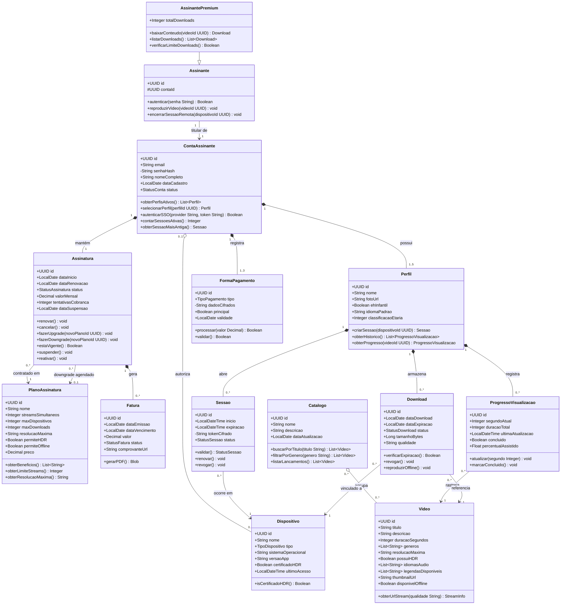
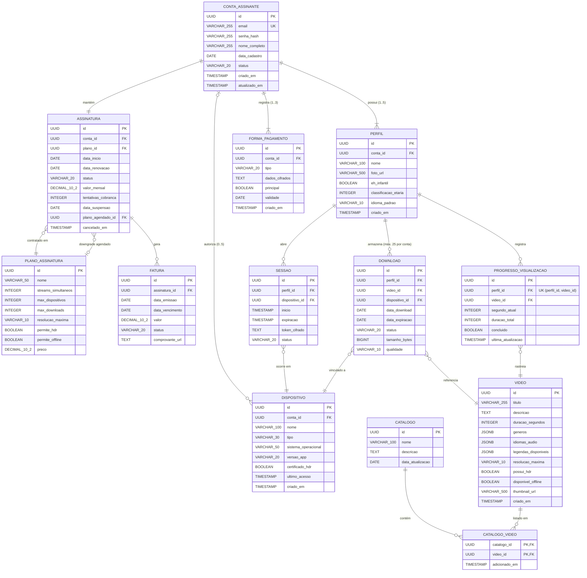
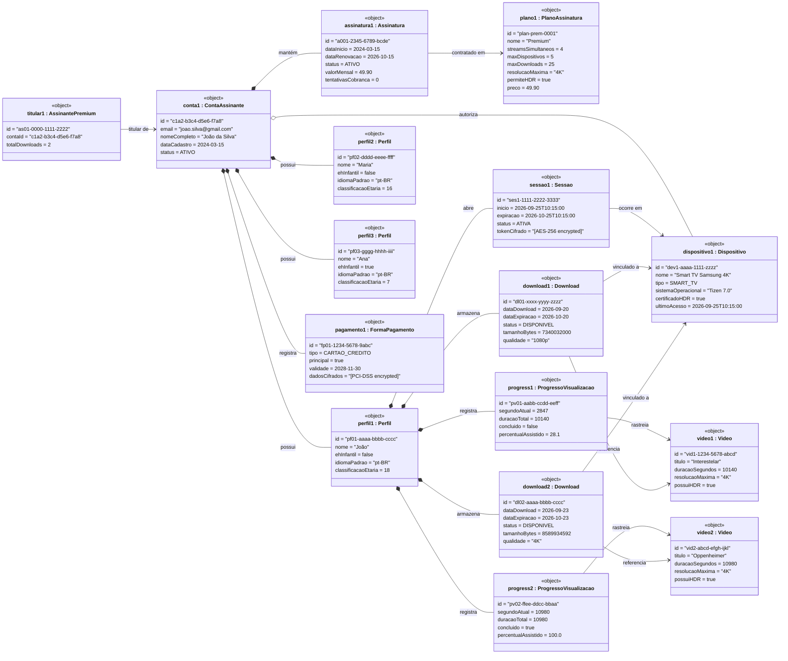
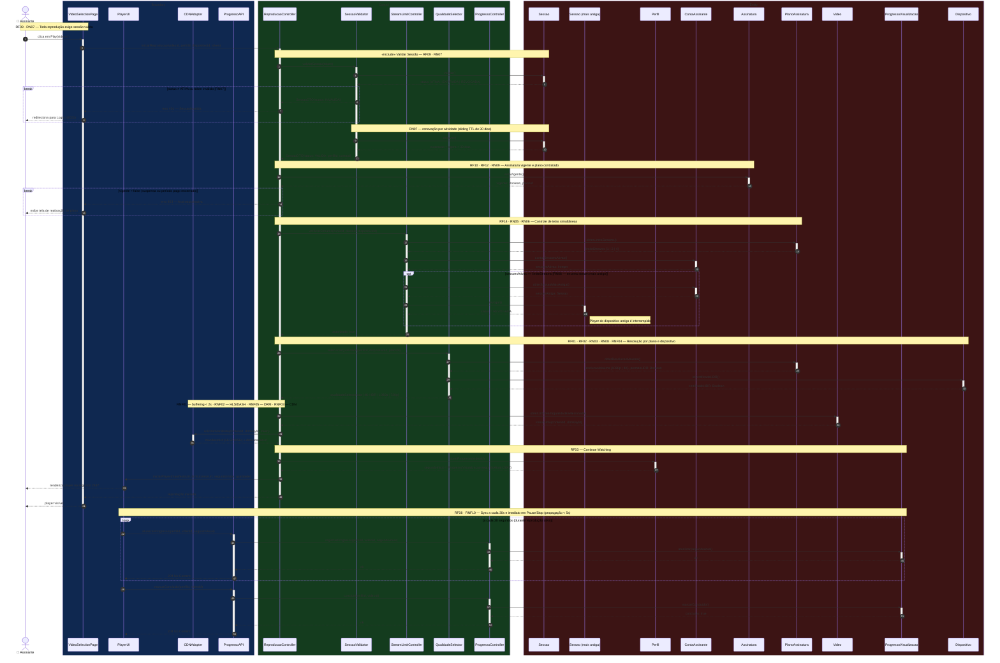
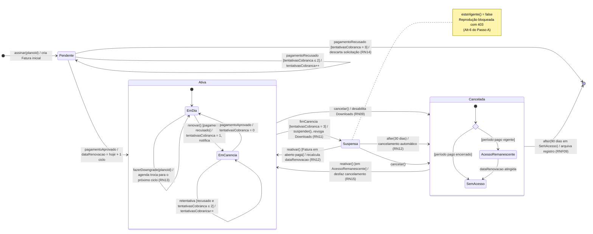
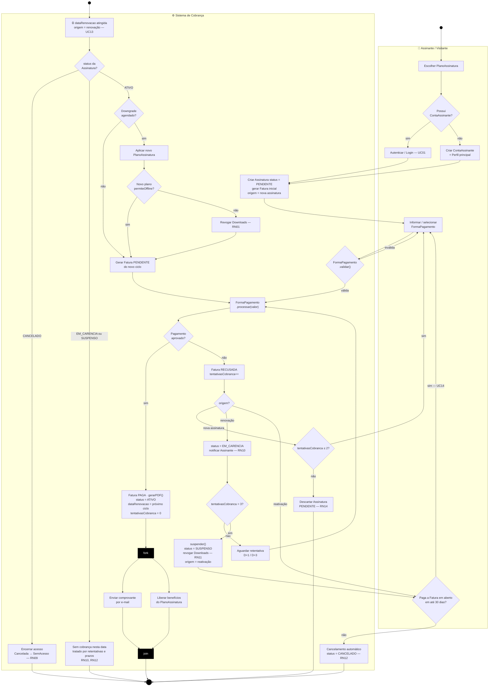
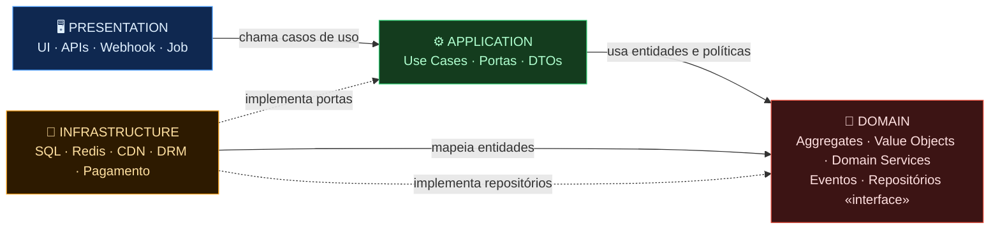
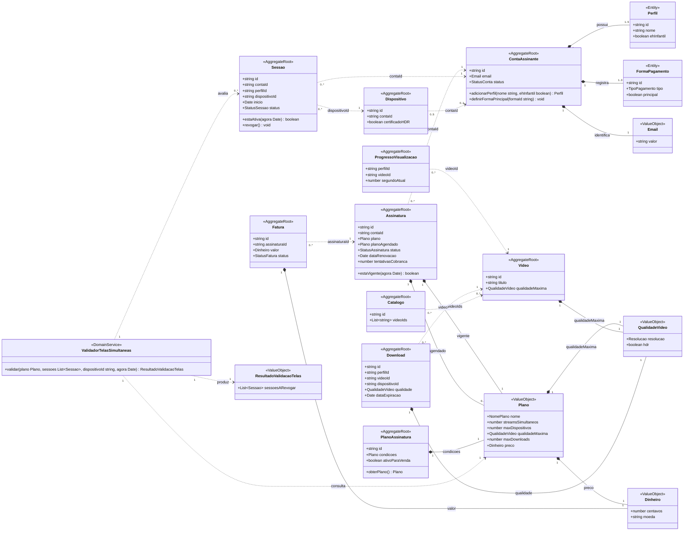

# SDD — Plataforma de Streaming de Mídia
### Software Design Document

---

## Metadados

| Campo | Valor |
|-------|-------|
| **Projeto** | Plataforma de Streaming — Gestão de Assinaturas e VOD |
| **Versão** | 1.0 |
| **Domínio** | Gestão de Assinaturas e Reprodução sob Demanda |
| **Responsável** | Arquiteto de Streaming |
| **Última atualização** | 2026-09-25 |
| **Status** | Revisado — versão final (Self-Correction Loop, Seção 8) |

---

## Histórico de Versões

| Versão | Data | Descrição | Prompt |
|--------|------|-----------|--------|
| 0.1 | 2026-09-25 | Fase 1 — Tree-of-Thought: Requisitos e Casos de Uso | P-01 |
| 0.2 | 2026-09-25 | Fase 2 — Diagramas de Classes, DER e Objetos | P-02 |
| 0.3 | 2026-09-25 | Passo A — Tabela BCE e Diagrama de Sequência (UC04) | P-03 |
| 0.4 | 2026-09-25 | Revisão de consistência (errata das Seções 1–3) | P-04 |
| 0.5 | 2026-09-25 | Passo B — Diagrama de Estados e Diagrama de Atividades (Assinatura) | P-05 |
| 0.6 | 2026-09-25 | Passo C — Diagrama de Componentes (Clean Architecture) | P-06 |
| 0.7 | 2026-09-25 | Mapeamento DDD + Clean Architecture, árvore `src/` e Plano de Testes TDD | P-07 |
| 1.0 | 2026-09-25 | Self-Correction Loop: checklist, consistência cruzada e 29 correções | P-08 |

---

## Glossário

| Termo | Definição |
|-------|-----------|
| **ABR** | Adaptive Bitrate — troca dinâmica de qualidade de vídeo conforme largura de banda |
| **Aggregate** | Conjunto de entidades e Value Objects tratados como uma unidade de consistência; alterado só por meio do **Aggregate Root** |
| **Aggregate Root** | Entidade de entrada de um Aggregate: única referenciável de fora e única persistida pelo repositório |
| **Assinante** | Usuário com plano ativo (Básico, Standard ou Premium) |
| **AssinantePremium** | Especialização de Assinante com acesso a Download Offline e 4K HDR |
| **BCE** | Boundary-Control-Entity — padrão de separação de responsabilidades em análise OO |
| **Bounded Context** | Fronteira explícita dentro da qual um modelo de domínio e sua linguagem ubíqua são consistentes |
| **Carência** | Período de até 3 dias após recusa na renovação em que o acesso é mantido enquanto ocorrem retentativas de cobrança (RN10) |
| **CDN** | Content Delivery Network — rede de distribuição de conteúdo com PoPs regionais |
| **Clean Architecture** | Arquitetura em camadas concêntricas (Domain, Application, Infrastructure/Presentation) em que o código só depende de camadas mais internas |
| **Continue Watching** | Funcionalidade de retomada automática do ponto de pausa anterior |
| **Domain Service** | Operação de domínio sem estado que não pertence naturalmente a nenhuma entidade (ex.: `ValidadorTelasSimultaneas`) |
| **DRM** | Digital Rights Management — proteção de conteúdo licenciado (Widevine, FairPlay, PlayReady) |
| **DTO** | Data Transfer Object — estrutura de dados que cruza fronteiras de camada sem expor entidades |
| **HLS** | HTTP Live Streaming — protocolo adaptativo da Apple |
| **LGPD** | Lei Geral de Proteção de Dados (Lei 13.709/2018) |
| **MPEG-DASH** | Dynamic Adaptive Streaming over HTTP — protocolo adaptativo aberto |
| **PCI-DSS** | Padrão de segurança para dados de cartão de pagamento |
| **Perfil** | Sub-identidade dentro de uma ContaAssinante (até 5 por conta) |
| **PlanoAssinatura** | Conjunto de benefícios e restrições associados a um nível de assinatura |
| **Porta (Port)** | Interface definida na camada Application e implementada por um adaptador de Infrastructure — o mecanismo de inversão de dependência |
| **Pro-rata** | Cobrança proporcional aos dias restantes do ciclo, aplicada no upgrade de plano (RN13) |
| **Regra de Dependência** | Princípio da Clean Architecture: dependências de código-fonte apontam apenas para dentro, em direção ao Domain |
| **Sessão** | Token autenticado com TTL de 30 dias, vinculado a Perfil e Dispositivo |
| **Sliding TTL** | Renovação por atividade: cada uso de uma sessão válida estende sua expiração; sessões já expiradas não são renovadas |
| **Stream Simultâneo** | Instância de reprodução ativa em um dispositivo; limitado por plano |
| **TDD** | Test-Driven Development — ciclo Red (teste falha) → Green (mínimo para passar) → Refactor |
| **ToT** | Tree-of-Thought — técnica de raciocínio estruturado em múltiplos ramos independentes |
| **Value Object** | Objeto imutável, sem identidade, comparado pelos seus valores (ex.: `QualidadeVideo`, `Plano`) |
| **VOD** | Video on Demand — reprodução assíncrona de conteúdo sob demanda |

---

## Seção 1 — Tree-of-Thought: Requisitos e Casos de Uso

> **Prompt:** P-01 · **Data:** 2026-09-25 · **Método:** Tree-of-Thought (3 ramos)

### 1.1 Geração dos Ramos

#### 🌿 Ramo A — Foco em Monetização

**Premissa central:** O sistema existe para maximizar receita recorrente. Cada funcionalidade deve ser avaliada pelo impacto no LTV (Lifetime Value) do assinante, churn rate e conversão de planos.

**Requisitos Funcionais**

| ID | Descrição |
|----|-----------|
| RF-A01 | O sistema deve suportar múltiplos planos de assinatura (Básico, Standard, Premium) com preços e benefícios distintos. |
| RF-A02 | O sistema deve processar pagamentos recorrentes via cartão de crédito, boleto e PIX. |
| RF-A03 | O sistema deve oferecer período de trial gratuito (7 ou 30 dias) configurável por campanha. |
| RF-A04 | O sistema deve notificar o assinante sobre falha de cobrança e oferecer janela de reativação. |
| RF-A05 | O sistema deve exibir recomendações de upgrade de plano com base no padrão de uso. |
| RF-A06 | O sistema deve controlar acesso ao catálogo por nível de plano (ex.: 4K apenas Premium). |
| RF-A07 | O sistema deve registrar histórico de faturas e permitir download de comprovantes. |
| RF-A08 | O sistema deve gerenciar cupons e promoções com data de validade e limite de uso. |

**Requisitos Não Funcionais**

| ID | Descrição |
|----|-----------|
| RNF-A01 | O gateway de pagamento deve responder em < 3s em 99% das transações. |
| RNF-A02 | O sistema deve garantir disponibilidade de 99,95% para o módulo de cobrança. |
| RNF-A03 | Dados de cartão de crédito devem ser armazenados em conformidade com PCI-DSS. |
| RNF-A04 | O sistema deve suportar até 100.000 transações simultâneas em picos sazonais. |

**Regras de Negócio**

| ID | Descrição |
|----|-----------|
| RN-A01 | O downgrade de plano só tem efeito no próximo ciclo de cobrança. |
| RN-A02 | O período de trial não pode ser usufruído mais de uma vez por CPF/e-mail. |
| RN-A03 | Em caso de falha de cobrança, o acesso é suspenso após 3 dias de carência. |
| RN-A04 | Cupons não são acumuláveis com outras promoções ativas. |

**Casos de Uso**

| ID | Nome | Ator Principal |
|----|------|----------------|
| UC-A01 | Assinar Plano | Visitante |
| UC-A02 | Fazer Upgrade/Downgrade de Plano | Assinante |
| UC-A03 | Gerenciar Forma de Pagamento | Assinante |
| UC-A04 | Visualizar Histórico de Faturas | Assinante |
| UC-A05 | Aplicar Cupom Promocional | Assinante |
| UC-A06 | Cancelar Assinatura | Assinante |
| UC-A07 | Reativar Assinatura Suspensa | Assinante |
| UC-A08 | Processar Cobrança Recorrente | Sistema (Automático) |

---

#### 🌿 Ramo B — Foco em Experiência de Reprodução

**Premissa central:** O coração da plataforma é a qualidade e fluidez da reprodução. O sistema deve garantir experiência cinematográfica: adaptive bitrate, baixa latência, continuidade entre sessões e personalização de exibição.

**Requisitos Funcionais**

| ID | Descrição |
|----|-----------|
| RF-B01 | O sistema deve reproduzir vídeo em resolução adaptativa (360p a 4K HDR) conforme largura de banda disponível. |
| RF-B02 | O sistema deve permitir ao usuário selecionar manualmente a qualidade de vídeo. |
| RF-B03 | O sistema deve retomar a reprodução do ponto exato onde o usuário parou (continue watching). |
| RF-B04 | O sistema deve suportar legendas em múltiplos idiomas e audiodescrição. |
| RF-B05 | O sistema deve permitir download de conteúdo para reprodução offline (AssinantePremium). |
| RF-B06 | O sistema deve controlar velocidade de reprodução (0,5x a 2x). |
| RF-B07 | O sistema deve exibir prévia (preview) ao passar o cursor na barra de progresso. |
| RF-B08 | O sistema deve registrar progresso de visualização por perfil de usuário. |
| RF-B09 | O sistema deve validar a sessão ativa antes de iniciar qualquer reprodução. |

**Requisitos Não Funcionais**

| ID | Descrição |
|----|-----------|
| RNF-B01 | O tempo de buffering inicial deve ser < 2s em conexões de 10 Mbps. |
| RNF-B02 | O player deve suportar protocolos HLS e DASH com fallback automático. |
| RNF-B03 | O sistema deve usar CDN com pontos de presença em todas as regiões do Brasil. |
| RNF-B04 | A latência de troca de qualidade adaptativa deve ser < 500ms. |
| RNF-B05 | O sistema deve suportar DRM (Widevine, FairPlay, PlayReady) para proteção de conteúdo. |

**Regras de Negócio**

| ID | Descrição |
|----|-----------|
| RN-B01 | Download offline está restrito a AssinantePremium e expira em 30 dias ou no cancelamento da assinatura. |
| RN-B02 | Cada AssinantePremium pode ter no máximo 25 títulos baixados simultaneamente. |
| RN-B03 | A reprodução em 4K HDR é exclusiva para planos Premium em dispositivos certificados. |
| RN-B04 | O conteúdo baixado só pode ser reproduzido no dispositivo onde foi baixado. |

**Casos de Uso**

| ID | Nome | Ator Principal |
|----|------|----------------|
| UC-B01 | Reproduzir Vídeo | Assinante |
| UC-B02 | Download Offline | AssinantePremium |
| UC-B03 | Selecionar Qualidade de Vídeo | Assinante |
| UC-B04 | Ativar Legendas / Audiodescrição | Assinante |
| UC-B05 | Retomar Reprodução | Assinante |
| UC-B06 | Validar Sessão | Sistema |
| UC-B07 | Registrar Progresso de Visualização | Sistema |

---

#### 🌿 Ramo C — Foco em Multi-Dispositivo

**Premissa central:** O usuário moderno consome conteúdo em múltiplas superfícies (TV, mobile, web, console). O sistema deve orquestrar identidade, sessões e limites de stream por plano de forma coerente em todos os dispositivos.

**Requisitos Funcionais**

| ID | Descrição |
|----|-----------|
| RF-C01 | O sistema deve permitir acesso a partir de até N dispositivos simultâneos definidos por plano. |
| RF-C02 | O sistema deve manter lista de dispositivos registrados por conta. |
| RF-C03 | O sistema deve permitir ao assinante revogar acesso de dispositivos remotamente. |
| RF-C04 | O sistema deve sincronizar perfis, histórico e watchlist entre todos os dispositivos. |
| RF-C05 | O sistema deve suportar múltiplos perfis por conta (inclusive perfil infantil com controle de conteúdo). |
| RF-C06 | O sistema deve detectar e bloquear compartilhamento de senha fora do domicílio. |
| RF-C07 | O sistema deve suportar autenticação por SSO (Google, Apple ID, Facebook). |
| RF-C08 | O sistema deve adaptar interface para cada tipo de dispositivo (responsividade). |

**Requisitos Não Funcionais**

| ID | Descrição |
|----|-----------|
| RNF-C01 | A sincronização de estado de visualização entre dispositivos deve ocorrer em < 5s. |
| RNF-C02 | O sistema deve suportar iOS, Android, Web, Samsung TV, Apple TV, Roku e consoles. |
| RNF-C03 | A autenticação SSO deve seguir protocolos OAuth 2.0 / OpenID Connect. |
| RNF-C04 | O sistema deve criptografar tokens de sessão em trânsito e em repouso (AES-256). |

**Regras de Negócio**

| ID | Descrição |
|----|-----------|
| RN-C01 | Plano Básico: 1 stream simultâneo, 1 dispositivo. Standard: 2 streams, 3 dispositivos. Premium: 4 streams, 5 dispositivos. |
| RN-C02 | Exceder o limite de streams simultâneos bloqueia o stream mais antigo automaticamente. |
| RN-C03 | Perfis infantis não podem ser configurados como perfil principal da conta. |
| RN-C04 | O compartilhamento de senha fora do domicílio pode ser monetizado via "membro extra". |

**Casos de Uso**

| ID | Nome | Ator Principal |
|----|------|----------------|
| UC-C01 | Gerenciar Dispositivos | Assinante |
| UC-C02 | Criar / Editar Perfil | Assinante |
| UC-C03 | Autenticar via SSO | Visitante / Assinante |
| UC-C04 | Revogar Dispositivo Remoto | Assinante |
| UC-C05 | Controlar Limite de Streams | Sistema |
| UC-C06 | Sincronizar Watchlist | Sistema |
| UC-C07 | Detectar Compartilhamento Indevido | Sistema |

---

### 1.2 Avaliação dos Ramos (Scoring)

| Critério | Peso | Ramo A (Monetização) | Ramo B (Reprodução) | Ramo C (Multi-Dispositivo) |
|----------|------|-----------------------|----------------------|----------------------------|
| **Completude** | 25% | 3 — Forte em assinaturas, fraco em VOD | **5** — VOD completo, assinatura presente | 3 — Dispositivos cobertos, VOD ausente |
| **Viabilidade Técnica** | 25% | **5** — APIs de pagamento maduras | **5** — CDN/HLS/DASH/DRM consolidados | 4 — SSO padrão, detecção de HH complexa |
| **Aderência ao Domínio** | 25% | 4 — Assinaturas sim, streaming secundário | **5** — Coração do negócio de streaming | 4 — Suporte ao streaming, não é o core |
| **Corretude UML** | 25% | 2 — include/extend não naturais | **5** — Validar Sessão + Download naturais | 3 — include presente, extend forçado |
| **TOTAL (ponderado)** | | **3,50** | **5,00** | **3,50** |

### 1.3 Poda dos Ramos Fracos

**❌ Ramo A — Eliminado:** Baixa aderência ao domínio de reprodução. Casos de uso majoritariamente financeiros não comportam de forma natural os relacionamentos UML obrigatórios. Imposição desses relacionamentos resultaria em diagrama forçado e semanticamente incorreto.

**❌ Ramo C — Eliminado:** Foco em infraestrutura de dispositivos, sem cobertura do core VOD. Detecção de compartilhamento e sincronização são características de suporte. Ausência natural do `<<extend>>` Download Offline prejudicou corretude UML.

**✅ Ramo B — Vencedor (Score: 5,00):** Único ramo que acomoda naturalmente todos os relacionamentos UML obrigatórios, cobre o domínio completo de Assinaturas+VOD e apresenta viabilidade técnica máxima. Consolida absorção seletiva de elementos de A (planos, billing) e C (dispositivos, SSO).

---

### 1.4 Requisitos Consolidados (Ramo B + Absorção Seletiva)

#### Requisitos Funcionais

| ID | Descrição |
|----|-----------|
| RF01 | O sistema deve reproduzir vídeo em resolução adaptativa (ABR: 360p a 4K HDR) conforme largura de banda disponível. |
| RF02 | O sistema deve permitir ao usuário selecionar manualmente a qualidade de vídeo durante a reprodução. |
| RF03 | O sistema deve retomar a reprodução do ponto exato onde o usuário parou em qualquer sessão anterior (*Continue Watching*). |
| RF04 | O sistema deve suportar legendas em múltiplos idiomas, audiodescrição e seleção de faixa de áudio. |
| RF05 | O sistema deve permitir download de conteúdo para reprodução offline, exclusivamente para AssinantePremium. |
| RF06 | O sistema deve controlar velocidade de reprodução (0,5x a 2,0x). |
| RF07 | O sistema deve exibir miniatura de prévia (*thumbnail scrubbing*) ao interagir com a barra de progresso. |
| RF08 | O sistema deve registrar e sincronizar o progresso de visualização por perfil de usuário. |
| RF09 | O sistema deve validar a sessão ativa do usuário antes de iniciar qualquer operação de reprodução ou download. |
| RF10 | O sistema deve suportar múltiplos planos de assinatura (Básico, Standard, Premium) com controle de acesso ao catálogo. |
| RF11 | O sistema deve processar a autenticação do usuário via e-mail/senha e SSO (OAuth 2.0). |
| RF12 | O sistema deve aplicar controle de acesso baseado em plano (ex.: 4K e Download apenas para Premium). |
| RF13 | O sistema deve permitir ao Assinante gerenciar dispositivos autorizados e encerrar sessões remotamente. |
| RF14 | O sistema deve controlar o número máximo de streams simultâneos por plano. |
| RF15 | O sistema deve processar a cobrança recorrente e a renovação automática da assinatura, com retentativas em caso de recusa. *(v0.5)* |
| RF16 | O sistema deve permitir ao Assinante cancelar, reativar e alterar (upgrade/downgrade) o plano de assinatura. *(v0.5)* |

#### Requisitos Não Funcionais

| ID | Descrição |
|----|-----------|
| RNF01 | O tempo de buffering inicial deve ser inferior a 2 segundos em conexões de 10 Mbps. |
| RNF02 | O player deve suportar os protocolos HLS e MPEG-DASH, com fallback automático entre protocolos. |
| RNF03 | O sistema deve utilizar CDN com cobertura nacional e internacional, com latência de entrega de conteúdo < 50ms. |
| RNF04 | A troca de faixa de qualidade no ABR deve ocorrer em < 500ms sem interrupção perceptível de reprodução. |
| RNF05 | O sistema deve implementar DRM (Widevine, FairPlay, PlayReady) para todos os conteúdos licenciados. |
| RNF06 | A disponibilidade do serviço de streaming deve ser ≥ 99,9% (SLA mensal), com RTO < 1h e RPO < 15min. |
| RNF07 | O sistema deve suportar até 500.000 sessões de streaming simultâneas com escalabilidade horizontal automática. |
| RNF08 | Todos os tokens de sessão devem ser cifrados com AES-256 em repouso e transmitidos via TLS 1.3. |
| RNF09 | O sistema deve estar em conformidade com a LGPD para dados de visualização e perfis de usuário. |
| RNF10 | A sincronização do progresso de visualização entre dispositivos deve ocorrer em < 5 segundos. |

#### Regras de Negócio

| ID | Descrição |
|----|-----------|
| RN01 | Download offline está disponível **exclusivamente** para AssinantePremium e expira em 30 dias após o download ou no cancelamento/downgrade da assinatura, o que ocorrer primeiro. |
| RN02 | Cada AssinantePremium pode ter no máximo 25 títulos baixados simultaneamente por conta. |
| RN03 | A reprodução em 4K HDR é exclusiva para planos Premium em dispositivos certificados HDR. |
| RN04 | O conteúdo baixado para uso offline só pode ser reproduzido no dispositivo onde foi originalmente baixado (vinculação por DRM). |
| RN05 | Plano Básico: 1 stream simultâneo. Plano Standard: 2 streams simultâneos. Plano Premium: 4 streams simultâneos. |
| RN06 | Exceder o limite de streams simultâneos bloqueia o stream com sessão mais antiga automaticamente. |
| RN07 | Toda operação de reprodução, download ou gerenciamento de sessão exige que a sessão do usuário esteja válida e não expirada (TTL de sessão: 30 dias com renovação automática por atividade). |
| RN08 | Assinantes em plano Básico acessam catálogo com resolução máxima de 1080p e sem HDR. |
| RN09 | O cancelamento da assinatura mantém o acesso até o fim do período pago corrente; downloads são desabilitados imediatamente. |
| RN10 | Recusa na cobrança de renovação abre carência de 3 dias com até 3 tentativas (D+0, D+1, D+3); durante a carência o acesso é mantido. *(v0.5, absorvida de RN-A03)* |
| RN11 | Esgotadas as 3 tentativas sem pagamento, a assinatura é suspensa: reprodução bloqueada e downloads offline revogados. *(v0.5)* |
| RN12 | Assinatura suspensa pode ser reativada em até 30 dias mediante pagamento da fatura em aberto, com `dataRenovacao` recalculada a partir do pagamento; após esse prazo é cancelada automaticamente. *(v0.5)* |
| RN13 | Upgrade de plano tem efeito imediato com cobrança pro-rata; downgrade só tem efeito no próximo ciclo de cobrança. *(v0.5, absorvida de RN-A01)* |
| RN14 | A assinatura só é ativada após a aprovação do primeiro pagamento; após 3 recusas a solicitação é descartada. *(v0.5)* |
| RN15 | O cancelamento voluntário pode ser revertido sem nova cobrança enquanto houver acesso remanescente do período pago. *(v0.5)* |

---

### 1.5 Diagrama de Casos de Uso

```mermaid
flowchart TD
    Visitante(["👤 Visitante"])
    Assinante(["👤 Assinante"])
    AssinantePremium(["👤 AssinantePremium"])
    Sistema(["⚙️ Sistema"])

    AssinantePremium -->|"generalização --|> (herda de)"| Assinante

    UC01["UC01<br/>Autenticar / Login"]
    UC02["UC02<br/>Validar Sessão<br/>«include»"]
    UC03["UC03<br/>Buscar Conteúdo"]
    UC04["UC04<br/>Reproduzir Vídeo"]
    UC05["UC05<br/>Download Offline<br/>«extend» (Premium)"]
    UC06["UC06<br/>Retomar Reprodução"]
    UC07["UC07<br/>Selecionar Qualidade"]
    UC08["UC08<br/>Ativar Legendas /<br/>Audiodescrição"]
    UC09["UC09<br/>Gerenciar Dispositivos"]
    UC10["UC10<br/>Encerrar Sessão Remota"]
    UC11["UC11<br/>Registrar Progresso<br/>de Visualização"]
    UC12["UC12<br/>Assinar Plano"]
    UC13["UC13<br/>Processar Renovação<br/>Recorrente"]
    UC14["UC14<br/>Reativar Assinatura"]
    UC15["UC15<br/>Cancelar Assinatura"]
    UC16["UC16<br/>Alterar Plano"]

    Visitante --> UC01
    Assinante --> UC03
    Assinante --> UC04
    Assinante --> UC06
    Assinante --> UC07
    Assinante --> UC08
    Assinante --> UC09
    Assinante --> UC10
    AssinantePremium --> UC05
    Sistema --> UC11
    Visitante --> UC12
    Sistema --> UC13
    Assinante --> UC14
    Assinante --> UC15
    Assinante --> UC16

    UC04 -.->|"«include»"| UC02
    UC05 -.->|"«include»"| UC02
    UC06 -.->|"«include»"| UC02
    UC09 -.->|"«include»"| UC02
    UC10 -.->|"«include»"| UC02
    UC14 -.->|"«include»"| UC02
    UC15 -.->|"«include»"| UC02
    UC16 -.->|"«include»"| UC02
    UC05 -.->|"«extend»<br/>condição: plano=Premium"| UC04

    classDef actor fill:#1e3a5f,stroke:#4a9eff,color:#fff,rx:50
    classDef usecase fill:#0d2137,stroke:#4a9eff,color:#e0f0ff,rx:8
    classDef include fill:#0d3320,stroke:#2ecc71,color:#afffcf,rx:8
    classDef extend fill:#2d1a00,stroke:#f39c12,color:#ffe0a0,rx:8

    class Visitante,Assinante,AssinantePremium,Sistema actor
    class UC01,UC03,UC04,UC06,UC07,UC08,UC09,UC10,UC11,UC12,UC13,UC14,UC15,UC16 usecase
    class UC02 include
    class UC05 extend
```



### 1.6 Rastreabilidade: Caso de Uso × Ator × RF

| Caso de Uso | ID UC | Ator Principal | RF(s) Relacionado(s) | Relacionamento UML |
|-------------|-------|----------------|----------------------|--------------------|
| Autenticar / Login | UC01 | Visitante | RF11 | — |
| Validar Sessão | UC02 | Sistema | RF09, RN07 | `«include»` em UC04, UC05, UC06, UC09, UC10, UC14, UC15, UC16 |
| Buscar Conteúdo | UC03 | Assinante | RF10, RF12 | — |
| Reproduzir Vídeo | UC04 | Assinante | RF01, RF02, RF06, RF07, RF10, RF12, RF14 *(RF10 em v1.0)* | `«include»` UC02; base do `«extend»` UC05 |
| Download Offline | UC05 | AssinantePremium | RF05, RF12, RN01, RN02, RN04 | `«extend»` UC04 + `«include»` UC02 |
| Retomar Reprodução | UC06 | Assinante | RF03, RF08 | `«include»` UC02 |
| Selecionar Qualidade | UC07 | Assinante | RF02, RF12, RN03, RN08 | — |
| Ativar Legendas / Audiodescrição | UC08 | Assinante | RF04 | — |
| Gerenciar Dispositivos | UC09 | Assinante | RF13, RN05, RN06 | `«include»` UC02 |
| Encerrar Sessão Remota | UC10 | Assinante | RF13, RF09 | `«include»` UC02 |
| Registrar Progresso de Visualização | UC11 | Sistema | RF08, RNF10 | — |
| Assinar Plano *(v0.5)* | UC12 | Visitante | RF10, RF11, RF15, RN14 | — |
| Processar Renovação Recorrente *(v0.5)* | UC13 | Sistema | RF15, RN10, RN11, RN13 | — |
| Reativar Assinatura *(v0.5)* | UC14 | Assinante | RF16, RN12, RN15 | `«include»` UC02 |
| Cancelar Assinatura *(v0.5)* | UC15 | Assinante | RF16, RN09 | `«include»` UC02 |
| Alterar Plano *(v0.5)* | UC16 | Assinante | RF10, RF16, RN01, RN13 | `«include»` UC02 |

#### Decisões de Modelagem — Casos de Uso *(v1.0)*

| Decisão | Justificativa |
|---------|---------------|
| Diagrama em `flowchart` | O Mermaid não tem diagrama de casos de uso nativo. Atores usam nós arredondados; `«include»` e `«extend»` usam setas tracejadas rotuladas. |
| Herança `AssinantePremium → Assinante` | A seta aponta do especializado para o geral, como na generalização UML (`--|>`). |
| UC07 e UC08 sem `«include»` UC02 | Só ocorrem dentro de uma reprodução em curso (UC04), que já validou a sessão. |
| UC05 como `«extend»` de UC04 | Download é opcional e condicionado ao plano (`permiteOffline`); o caso base não depende dele. |

---

## Seção 2 — Diagramas de Classes, DER e Objetos

> **Prompt:** P-02 · **Data:** 2026-09-25 · **Padrão:** RAG + Few-Shot

### 2.1 Diagrama de Classes

> `*--` Composição — a parte **não existe** sem o todo · `o--` Agregação — a parte **existe independentemente** · `--|>` Herança · `-->` Associação



#### Decisões de Modelagem

| Decisão | Justificativa |
|---------|---------------|
| `ContaAssinante *-- Perfil` (composição) | Perfil não tem existência própria fora de uma conta — exclusão da conta elimina todos os perfis em cascata. |
| `ContaAssinante *-- Assinatura` (composição) | A assinatura é criada e gerenciada exclusivamente dentro do ciclo de vida da conta. |
| `Catalogo o-- Video` (agregação) | Um vídeo pode pertencer a múltiplos catálogos e existe independentemente de estar em algum catálogo. |
| `ContaAssinante o-- Dispositivo` (agregação) | O mesmo dispositivo físico pode ser desvinculado e re-vinculado a outra conta. |
| `Perfil *-- Download` (composição) | Downloads são licenças DRM ligadas ao perfil — expiram ou são revogados junto com o perfil/cancelamento. |
| `AssinantePremium --|> Assinante` | Herança de generalização: Premium herda comportamentos base e adiciona `baixarConteudo()` e `listarDownloads()`. |
| `Assinante` concreta + `Assinante "1" --> "1" ContaAssinante` *(v0.4)* | `Assinante` representa o papel do usuário (ator) e `ContaAssinante` guarda os dados cadastrais — elimina a duplicação de atributos. `Assinante` deixou de ser abstrata porque assinantes Básico/Standard precisam ser instanciáveis. Não há tabela própria no DER: o papel é derivado de `CONTA_ASSINANTE` + `PLANO_ASSINATURA.permite_offline`. |
| Multiplicidades revisadas *(v1.0)* | `Perfil *-- "0..*" Download`: o limite de 25 é **por conta** (RN02), garantido pela `PoliticaDownload`, e não por perfil. `Catalogo "0..*" o-- "0..*" Video`: um vídeo pode estar em vários catálogos (N:M no DER). `ContaAssinante "0..1" o-- Dispositivo`: um dispositivo pertence a no máximo uma conta (FK `conta_id` anulável). |
| Métodos de consulta acrescentados *(v1.0)* | `contarSessoesAtivas()`, `obterSessaoMaisAntiga()`, `obterProgresso()`, `obterLimiteStreams()`, `obterResolucaoMaxima()` e `isCertificadoHDR()` são as mensagens do Diagrama de Sequência (3.2) no nível de análise. No projeto (Seção 7) elas viram consultas de repositório e Domain Services. |
| UUID como PK universal | Evita colisões em ambientes multi-região/multi-shard e elimina enumeração sequencial de IDs. |

---

### 2.2 Diagrama Entidade-Relacionamento (DER)

> PK = chave primária · FK = chave estrangeira · UK = unique key



#### Decisões de Modelagem — DER *(v1.0)*

| Decisão | Justificativa |
|---------|---------------|
| `||--|{` para `PERFIL` e `FORMA_PAGAMENTO` | Espelha as multiplicidades `1..5` e `1..3` do Diagrama de Classes: a conta tem **ao menos um** de cada. O teto é garantido no aggregate `ContaAssinante` (Seção 7.2). |
| `|o--o{` para `DISPOSITIVO` | `conta_id` anulável: o dispositivo pode ser desvinculado e vinculado de novo (agregação). |
| PK composta em `CATALOGO_VIDEO` | Impede o mesmo vídeo duplicado no mesmo catálogo. |
| UK `(perfil_id, video_id)` em `PROGRESSO_VISUALIZACAO` | Um progresso por perfil e vídeo: é a identidade do aggregate (Seção 7.2). |
| `JSONB` para `generos`, `idiomas_audio` e `legendas_disponiveis` | Mapeia os atributos `List~String~` de `Video` sem tabelas auxiliares; são lidos em bloco com o vídeo. |
| Sem `conta_id` em `SESSAO` | Obtido via `PERFIL.conta_id` (JOIN), o que evita redundância (Seção 7.4). |

---

### 2.3 Diagrama de Objetos

> **Cenário:** ContaAssinante `joao.silva@gmail.com` — Plano Premium ativo com 3 perfis, 1 sessão ativa, 2 progressos e 2 downloads offline.



#### Decisões de Modelagem — Objetos *(v1.0)*

| Decisão | Justificativa |
|---------|---------------|
| `duracaoTotal` igual a `Video.duracaoSegundos` | `progress1` (Interestelar, 10140 s) e `progress2` (Oppenheimer, 10980 s) precisam refletir a duração real do vídeo rastreado. `percentualAssistido` = 2847 / 10140 = 28,1%. |
| `segundoAtual = 2847` | É o mesmo valor usado no Continue Watching do Diagrama de Sequência (3.2). |
| `titular1 : AssinantePremium` | O plano `Premium` (`permiteOffline`) justifica os 2 downloads; `totalDownloads = 2` bate com `download1` e `download2`. |
| 3 perfis e 1 forma de pagamento | Respeitam as multiplicidades `1..5` e `1..3` do Diagrama de Classes e do DER. |

---

## Seção 3 — Passo A: BCE + Diagrama de Sequência (UC04 — Reproduzir Vídeo)

> **Prompt:** P-03 · **Data:** 2026-09-25  
> **Rastreabilidade:** UC04 · RF01 · RF02 · RF03 · RF08 · RF09 · RF10 · RF12 · RF14 · RN03 · RN05 · RN06 · RN07 · RN09  
> *Revisado em v0.4 (P-04) — ver Seção 4.*

### 3.1 Tabela BCE

> **Boundary** — interface com atores externos · **Control** — orquestra regras de negócio · **Entity** — estado persistente do domínio

| # | Estereótipo | Nome | Responsabilidade | Classe de Origem |
|---|-------------|------|------------------|------------------|
| 1 | `<<Boundary>>` | **PlayerUI** | Renderiza o player; recebe Play, Pause, Seek, qualidade, legenda; exibe buffer e erros | — |
| 2 | `<<Boundary>>` | **VideoSelectionPage** | Apresenta catálogo; captura seleção de vídeo; encaminha `videoId` e `perfilId` ao controller | — |
| 3 | `<<Boundary>>` | **CDNAdapter** | Solicita URL do manifesto HLS/DASH; gerencia tokens de acesso temporários | — |
| 4 | `<<Boundary>>` | **ProgressoAPI** | Endpoint REST/WebSocket que recebe atualizações de progresso do player de forma assíncrona | — |
| 5 | `<<Control>>` | **ReproducaoController** | Orquestra o fluxo: validação de sessão → streams → manifesto → progresso | UC04 |
| 6 | `<<Control>>` | **SessaoValidator** | Valida token: assinatura, expiração (TTL 30 dias) e status; renova o TTL por atividade (sliding) apenas em sessões válidas — sessão expirada exige novo login (RN07) | Sessao |
| 7 | `<<Control>>` | **StreamLimitController** | Verifica e controla streams simultâneos; encerra sessão mais antiga se limite atingido | PlanoAssinatura · ContaAssinante |
| 8 | `<<Control>>` | **QualidadeSelector** | Seleciona resolução máxima por plano e dispositivo; aplica fallback ABR | PlanoAssinatura · Dispositivo |
| 9 | `<<Entity>>` | **Sessao** | Token cifrado, timestamps, status; expõe `validar()` e `revogar()` | Sessao |
| 10 | `<<Entity>>` | **Perfil** | Perfil ativo; idioma, classificação etária e histórico de visualização | Perfil |
| 11 | `<<Entity>>` | **ContaAssinante** | Referência raiz; lista sessões ativas em todos os dispositivos | ContaAssinante |
| 12 | `<<Entity>>` | **Assinatura** | Informa via `estaVigente()` se a assinatura está ativa ou dentro do período pago (RN09) e fornece o `planoId` | Assinatura |
| 13 | `<<Entity>>` | **PlanoAssinatura** | Fornece `streamsSimultaneos`, `resolucaoMaxima`, `permiteHDR`, `permiteOffline` | PlanoAssinatura |
| 14 | `<<Entity>>` | **Video** | Metadados e `obterUrlStream(qualidade)` para o CDNAdapter | Video |
| 15 | `<<Entity>>` | **ProgressoVisualizacao** | Registra `segundoAtual`, `concluido` e `ultimaAtualizacao` por `(perfilId, videoId)` | ProgressoVisualizacao |
| 16 | `<<Entity>>` | **Dispositivo** | Fornece `certificadoHDR` e `tipo` para autorização de stream 4K HDR | Dispositivo |
| 17 | `<<Control>>` | **ProgressoController** *(v1.0)* | Recebe atualizações da `ProgressoAPI` e as aplica em `ProgressoVisualizacao`. Evita que um Boundary fale direto com uma Entity. | UC11 |

#### Mapa BCE Visual

```
┌──────────────────────────────────────────────────────────────────────┐
│                           BOUNDARY                                    │
│  VideoSelectionPage  │  PlayerUI  │  CDNAdapter  │  ProgressoAPI     │
└──────────────────┬──────────────┬──────────────┬─────────────────────┘
                   │              │              │
┌──────────────────▼──────────────▼──────────────▼─────────────────────┐
│                            CONTROL                                    │
│  ReproducaoController  │  SessaoValidator  │  StreamLimitController   │
│         QualidadeSelector   │   ProgressoController                   │
└─────────┬───────────────────────┬─────────────────────┬──────────────┘
          │                       │                     │
┌─────────▼───────────────────────▼─────────────────────▼──────────────┐
│                             ENTITY                                    │
│  Sessao │ Perfil │ ContaAssinante │ Assinatura │ PlanoAssinatura      │
│  Video  │ ProgressoVisualizacao  │ Dispositivo                        │
└──────────────────────────────────────────────────────────────────────┘
```

---

### 3.2 Diagrama de Sequência — "Dar Play no Vídeo"

> **Pré-condição:** Assinante autenticado, perfil selecionado, vídeo escolhido no catálogo.  
> **Pós-condição:** Player inicializado, progresso sendo rastreado assincronamente.



### 3.3 Rastreabilidade BCE × RF × RN

| Trecho do Fluxo | Participantes BCE | RF | RN |
|---|---|---|---|
| Seleção e início | VideoSelectionPage (B), ReproducaoController (C) | RF09 | RN07 |
| Validar Sessão | SessaoValidator (C), Sessao (E) | RF09 | RN07 |
| Verificar assinatura vigente | ReproducaoController (C), Assinatura (E) | RF10, RF12 | RN09 |
| Verificar streams simultâneos | StreamLimitController (C), PlanoAssinatura (E), ContaAssinante (E), Sessao mais antiga (E) | RF14 | RN05, RN06 |
| Selecionar qualidade | QualidadeSelector (C), PlanoAssinatura (E), Dispositivo (E) | RF01, RF02 | RN03, RN08 |
| Obter manifesto CDN | CDNAdapter (B), Video (E) | RF01 | — |
| Continue Watching | ReproducaoController (C), Perfil (E) | RF03, RF08 | — |
| Inicializar player | PlayerUI (B) | RF01, RF04, RF06, RF07, RNF01 | — |
| Loop de progresso assíncrono | ProgressoAPI (B), ProgressoController (C), ProgressoVisualizacao (E) | RF08, RNF10 | — |

### 3.4 Fluxos Alternativos

| # | Condição | Consequência |
|---|----------|--------------|
| Alt-1 | Sessão **expirada** (TTL vencido) | Fluxo abortado com `401`; usuário redirecionado ao Login (RN07 — sessão expirada não é renovada). *Revisado em v0.4.* |
| Alt-2 | Sessão **revogada ou inválida** | Fluxo abortado com `401`; usuário redirecionado ao Login |
| Alt-3 | Streams **≥ limite do plano** | `StreamLimitController` revoga a sessão mais antiga e autoriza o novo stream — RN06 |
| Alt-4 | Dispositivo **sem certificado HDR** | `QualidadeSelector` faz downgrade automático para `1080p` mesmo em plano Premium |
| Alt-5 | Vídeo **sem progresso salvo** | `ProgressoVisualizacao` retorna `segundoAtual = 0`; reprodução inicia do começo |
| Alt-6 | Assinatura **não vigente** (suspensa ou período pago encerrado) | Fluxo abortado com `403 AssinaturaInativa`; usuário direcionado à reativação de plano — RN09. *Incluído em v0.4.* |

### 3.5 Decisões de Modelagem *(v1.0)*

| Decisão | Justificativa |
|---------|---------------|
| Boxes `Boundary` / `Control` / `Entity` com `autonumber` | Regra RAG do projeto: a sequência mostra a separação BCE e numera cada mensagem para rastreabilidade. |
| `break` nos caminhos de erro (401/403) | Encerra o fluxo sem ramos `alt` aninhados e mantém as ativações balanceadas (errata E01). |
| `ProgressoController` entre `ProgressoAPI` e `ProgressoVisualizacao` | No BCE, um Boundary só conversa com um Control; a chamada direta Boundary → Entity violava o padrão. |
| `status {ATIVA \| EXPIRADA \| REVOGADA}` | Igual ao enum `StatusSessao` (Seção 7.3) e ao Diagrama de Objetos (`sessao1.status = ATIVA`). `VALIDA`/`INVALIDA` ficam só no `SessaoDTO`. |
| Mensagens sem parâmetros de ID redundantes | `obterLimiteStreams()`, `isCertificadoHDR()` etc. são enviadas ao próprio objeto, então repassar o ID dele seria redundante. |

---

## Seção 4 — Revisão de Consistência (Errata v0.4)

> **Prompt:** P-04 · **Data:** 2026-09-25  
> **Objetivo:** corrigir erros de renderização Mermaid e inconsistências semânticas das Seções 1–3 antes do Passo B do Prompt Chaining. As correções foram aplicadas **no próprio local** (nenhuma seção removida); cada alteração está registrada abaixo.

### 4.1 Correções Aplicadas

| # | Seção | Problema | Correção | Rastreabilidade |
|---|-------|----------|----------|-----------------|
| E01 | 3.2 | `SessaoValidator` ativado 1× e desativado 2× (`-->>-`), o que quebra a renderização do Mermaid; o ramo EXPIRADA também devolvia duas respostas ao `ReproducaoController` | Validação reestruturada com `break` para o caminho de erro e uma única desativação de `SessaoValidator` | RF09 |
| E02 | 3.2 · 3.1 · 3.4 | Renovar sessão **expirada** contradizia RN07 ("válida e **não expirada**") | Sessão expirada agora aborta com `401`. `renovar()` só roda em sessão válida (sliding TTL, renovação por atividade) | RN07 |
| E03 | 3.2 · 3.3 · 3.4 | `Assinatura` estava na BCE mas não aparecia na sequência; `planoId` era usado sem ter sido obtido | Novo passo `estaVigente()` → `{vigente, planoId}` com `break` 403 (Alt-6); `planoId` passa a ser repassado a `StreamLimitController` e `QualidadeSelector` | RF10, RF12, RN09 |
| E04 | 3.2 · 3.3 | RN06 revogava o participante `Sessao` da sessão **atual** em vez da mais antiga | Novo participante `Sessao (mais antiga)`; alternativa `alt` substituída por `opt` com uma única resposta `autorizado: true` | RF14, RN06 |
| E05 | 2.1 · 2.3 | `Assinante` (abstrata) duplicava os atributos de `ContaAssinante` sem relacionamento entre elas; sendo abstrata e tendo só `AssinantePremium` como subclasse, assinantes Básico/Standard não podiam ser instanciados | `Assinante` concreta, sem atributos cadastrais, com `Assinante "1" --> "1" ContaAssinante : titular de`; objeto `titular1 : AssinantePremium` incluído no diagrama de objetos | RF10, RF12 |
| E06 | 2.1 | `Assinatura` não tinha operação para consultar a vigência (exigida por E03) | Adicionado `+estaVigente() Boolean` | RN09 |
| E07 | 1.5 | Seta de herança dos atores apontava de `Assinante` para `AssinantePremium` (sentido inverso da generalização) | Seta invertida: `AssinantePremium → Assinante` (herda de) | Regra UML obrigatória |
| E08 | 1.6 | UC02 descrito como `«include»` em "UC04–UC10", o que abrangia UC07 e UC08, que não incluem Validar Sessão | Lista explícita: UC04, UC05, UC06, UC09, UC10 | RF09 |

### 4.2 Pendências Conhecidas (não corrigidas nesta revisão)

| # | Pendência | Motivo |
|---|-----------|--------|
| P01 | Mensagens do diagrama de sequência sem operação correspondente no Diagrama de Classes (ex.: `contarSessoesAtivas`, `obterSessaoMaisAntiga`, `obterLimiteStreams`, `obterResolucaoMaxima`, `isCertificadoHDR`, `buscarProgresso`); `Video.obterUrlStream()` retorna `String` na classe e `streamInfo` na sequência | Alinhar classes a partir da sequência é refinamento natural das próximas etapas do Prompt Chaining |
| P02 | Controllers BCE (`ReproducaoController`, `SessaoValidator`, `StreamLimitController`, `QualidadeSelector`) ainda não aparecem no Diagrama de Classes de domínio | Pertencem ao modelo de projeto, não ao modelo de domínio |

---

## Seção 5 — Passo B: Diagrama de Estados e Diagrama de Atividades (Assinatura)

> **Prompt:** P-05 · **Data:** 2026-09-25  
> **Entidades do Passo A reutilizadas:** `Assinatura`, `PlanoAssinatura`, `FormaPagamento`, `Fatura`, `ContaAssinante`, `Perfil`, `Download`  
> **Rastreabilidade:** UC12 · UC13 · UC14 · UC15 · UC16 · RF10 · RF15 · RF16 · RN01 · RN09 · RN10 · RN11 · RN12 · RN13 · RN14 · RN15

> **Nota de consistência:** o ciclo de cobrança não tinha regras consolidadas, porque o Ramo A (Monetização) foi podado na Seção 1. Os elementos necessários foram absorvidos do Ramo A (RN-A01 → RN13, RN-A03 → RN10) e registrados diretamente nas tabelas da Seção 1.4 (RF15, RF16, RN10–RN15) e da Seção 1.6 (UC12–UC16), marcados com *(v0.5)*.

### 5.1 Enumeração `StatusAssinatura` × Estados

| Estado (diagrama) | Subestado | `StatusAssinatura` | `estaVigente()` | Reprodução (UC04) | Download (UC05) |
|---|---|---|---|---|---|
| **Pendente** | — | `PENDENTE` | `false` | ❌ | ❌ |
| **Ativa** | EmDia | `ATIVO` | `true` | ✅ | ✅ se `permiteOffline` |
| **Ativa** | EmCarencia | `EM_CARENCIA` | `true` | ✅ (RN10) | ✅ se `permiteOffline` |
| **Suspensa** | — | `SUSPENSO` | `false` | ❌ → `403` (Alt-6 do Passo A) | ❌ revogados (RN11) |
| **Cancelada** | AcessoRemanescente | `CANCELADO` | `true` | ✅ até `dataRenovacao` (RN09) | ❌ desabilitados (RN09) |
| **Cancelada** | SemAcesso | `CANCELADO` | `false` | ❌ → `403` | ❌ |

> Os valores seguem o gênero já usado no Diagrama de Objetos (`assinatura1.status = ATIVO`), em que o termo implícito é "status".

---

### 5.2 Diagrama de Estados — `Assinatura`

> **Notação:** `evento [guarda] / ação`. `after(t)` indica um evento temporal. Os estados compostos `Ativa` e `Cancelada` detalham os subestados.



#### Tabela de Transições (Eventos × Guardas × Ações)

| # | Origem → Destino | Evento | Guarda | Ação | Regra |
|---|---|---|---|---|---|
| T01 | `[*]` → Pendente | `assinar(planoId)` | — | Cria `Assinatura` (`PENDENTE`) e a `Fatura` inicial | RF15, RN14 |
| T02 | Pendente → Pendente | pagamento recusado | `tentativasCobranca ≤ 2` | `tentativasCobranca++`; pede outra `FormaPagamento` | RN14 |
| T03 | Pendente → Ativa | pagamento aprovado | — | `Fatura` → `PAGA`; `dataRenovacao = hoje + 1 ciclo` | RF15 |
| T04 | Pendente → `[*]` | pagamento recusado | `tentativasCobranca = 3` | Descarta a solicitação | RN14 |
| T05 | EmDia → EmDia | `renovar()` | pagamento aprovado | `dataRenovacao += 1 ciclo`; aplica downgrade agendado | RF15, RN13 |
| T06 | EmDia → EmDia | `fazerUpgrade(planoId)` | — | Cobrança pro-rata imediata; novo plano vigente | RF16, RN13 |
| T07 | EmDia → EmDia | `fazerDowngrade(planoId)` | — | Registra o plano agendado para o próximo ciclo | RF16, RN13 |
| T08 | EmDia → EmCarencia | `renovar()` | pagamento recusado | `tentativasCobranca = 1`; notifica o Assinante | RN10 |
| T09 | EmCarencia → EmCarencia | retentativa (D+1, D+3) | recusado e `tentativasCobranca ≤ 2` | `tentativasCobranca++` | RN10 |
| T10 | EmCarencia → EmDia | pagamento aprovado | — | `tentativasCobranca = 0` | RN10 |
| T11 | Ativa → Suspensa | fim da carência | `tentativasCobranca = 3` | `suspender()`; `dataSuspensao = hoje`; revoga `Download`s | RN11 |
| T12 | Ativa → Cancelada | `cancelar()` | — | Desabilita `Download`s imediatamente | RN09 |
| T13 | Suspensa → Ativa | `reativar()` | `Fatura` em aberto paga | Recalcula `dataRenovacao` a partir do pagamento | RF16, RN12 |
| T14 | Suspensa → Cancelada | `after(30 dias)` | — | Cancelamento automático | RN12 |
| T15 | Suspensa → Cancelada | `cancelar()` | — | — | RF16 |
| T16 | Cancelada → Ativa | `reativar()` | em AcessoRemanescente | Desfaz o cancelamento sem nova cobrança | RF16, RN15 |
| T17 | Cancelada → `[*]` | `after(90 dias)` | em SemAcesso | Arquiva o registro (retenção LGPD) | RNF09 |

---

### 5.3 Diagrama de Atividades — Assinatura e Renovação

> **Raias:** Assinante/Visitante (ações humanas) · Sistema de Cobrança (ações automáticas).  
> **Nós de início:** `●` início pela contratação (UC12) · `●` início pelo evento temporal `dataRenovacao` atingida (UC13).  
> A variável **origem** (nova assinatura | renovação | reativação) acompanha a cobrança e decide o fluxo em caso de recusa.



#### Fluxos Alternativos

| # | Condição | Consequência | Regra |
|---|----------|--------------|-------|
| FA-01 | Visitante sem `ContaAssinante` | Cria conta e perfil principal antes de gerar a `Assinatura` | RF11 |
| FA-02 | `FormaPagamento.validar()` falha (cartão vencido, dados inválidos) | Volta para a seleção de forma de pagamento sem cobrar | RF15 |
| FA-03 | Primeiro pagamento recusado até 2× | Pede outra `FormaPagamento`; a assinatura continua `PENDENTE` | RN14 |
| FA-04 | Primeiro pagamento recusado 3× | Solicitação descartada; nenhuma assinatura é ativada | RN14 |
| FA-05 | Downgrade agendado para o ciclo | Aplica o novo plano antes de cobrar; se ele não tiver `permiteOffline`, revoga os downloads | RN01, RN13 |
| FA-06 | Renovação recusada | Assinatura entra em `EM_CARENCIA` com acesso mantido; retentativas em D+1 e D+3 | RN10 |
| FA-07 | 3ª recusa na carência | `suspender()`: reprodução bloqueada, downloads revogados | RN11 |
| FA-08 | Suspensa e Fatura paga em até 30 dias | `reativar()`: volta a `ATIVO` com `dataRenovacao` recalculada | RN12 |
| FA-09 | Suspensa sem pagamento por 30 dias | Cancelamento automático | RN12 |
| FA-10 | `dataRenovacao` atingida com assinatura `CANCELADO` | Não cobra; encerra o acesso remanescente | RN09 |
| FA-11 | `dataRenovacao` atingida com assinatura `EM_CARENCIA` ou `SUSPENSO` *(v1.0)* | Nenhuma cobrança nova: o ciclo segue nas retentativas (RN10) ou no prazo de 30 dias (RN12) | RN10, RN12 |

---

### 5.4 Rastreabilidade: Trecho × UC × RF × RN × Entidades

| Trecho | UC | RF | RN | Entidades do Passo A |
|---|---|---|---|---|
| Contratação (A1–S1) | UC12, UC01 | RF10, RF11, RF15 | RN14 | ContaAssinante, Perfil, PlanoAssinatura, Assinatura, Fatura |
| Validação e cobrança (V1–C2) | UC12, UC13, UC14 | RF15 | RN14 | FormaPagamento, Fatura |
| Renovação e downgrade agendado (T0–S4) | UC13, UC16 | RF15, RF16 | RN01, RN13 | Assinatura, PlanoAssinatura, Download |
| Carência e suspensão (RC0–SU) | UC13 | RF15 | RN10, RN11 | Assinatura, Fatura, Download |
| Reativação (R1) | UC14 | RF16 | RN12, RN15 | Assinatura, Fatura, FormaPagamento |
| Cancelamento (CA, CX) | UC15 | RF16 | RN09, RN12 | Assinatura, Download |

### 5.5 Decisões de Modelagem

| Decisão | Justificativa |
|---------|---------------|
| `Ativa` como estado composto (`EmDia`, `EmCarencia`) | A carência não interrompe o acesso (RN10). Modelar como subestado de `Ativa` deixa `estaVigente()` = `true` sem criar um estado de topo a mais. |
| `Cancelada` como estado composto com `<<choice>>` | RN09 mantém o acesso até o fim do período pago. O ponto de escolha distingue um cancelamento voluntário (com saldo de período) de um cancelamento vindo de `Suspensa` (sem saldo). |
| Estado `Pendente` antes de `Ativa` | A assinatura só é ativada com o primeiro pagamento aprovado (RN14), o que evita acesso sem cobrança. |
| Evento temporal `after(30 dias)` em `Suspensa` | Limita o período de inadimplência e libera recursos (DRM, sessões). |
| `fazerUpgrade`/`fazerDowngrade` como autotransições em `EmDia` | Trocar de plano não muda o ciclo de vida da assinatura, só o `PlanoAssinatura` associado. Durante a carência a troca fica bloqueada. |
| Novos membros em `Assinatura` (2.1/2.2): `tentativasCobranca`, `dataSuspensao`, `suspender()`, `reativar()` e a associação `downgrade agendado` → `PlanoAssinatura` | São os dados e operações que as guardas e ações do diagrama de estados exigem. |
| Variável **origem** no diagrama de atividades | Um único subprocesso de cobrança (C1–C2) atende contratação, renovação e reativação. O tratamento da recusa depende da origem. |
| Raias via `subgraph` e fork/join como barras | O `flowchart` do Mermaid não tem raias nem barras de sincronização nativas; essa é a aproximação mais fiel à notação UML de atividades. |

---

## Seção 6 — Passo C: Diagrama de Componentes (Clean Architecture)

> **Prompt:** P-06 · **Data:** 2026-09-25  
> **Consolida:** Passo A (Seção 3: BCE + Sequência do UC04) e Passo B (Seção 5: Estados e Atividades da `Assinatura`)  
> *Revisado em v0.7 (P-07): repositórios movidos para o Domain e `PoliticaStreamsSimultaneos` → `ValidadorTelasSimultaneas` — ver Seção 7.8.*  
> **Rastreabilidade:** UC02 · UC04 · UC07 · UC11 · UC12 · UC13 · UC14 · UC15 · UC16 · RF01–RF16 · RNF02 · RNF03 · RNF05 · RNF07 · RNF08

### 6.1 Visão Geral — Regra de Dependência

> Toda dependência de código aponta **para dentro**: Presentation e Infrastructure (anel externo) → Application → Domain (núcleo). O Domain não conhece nenhuma outra camada.  
> `-->` usa / chama · `-.->` implementa (inversão de dependência via porta)



---

### 6.2 Diagrama de Componentes Detalhado

> **Leitura concêntrica:** `DOMAIN` está aninhado em `APPLICATION` para representar o núcleo da "cebola". As cores seguem os boxes do Diagrama de Sequência do Passo A: azul = Boundary/Presentation, verde = Control/Application, vermelho = Entity/Domain; laranja = Infrastructure.

```mermaid
flowchart TB
    subgraph PRES["🖥️ PRESENTATION — Adaptadores de Entrada"]
        direction LR
        subgraph CLI["Clientes · Web / Mobile / Smart TV"]
            VSP["«Boundary»<br/>VideoSelectionPage"]
            PLY["«Boundary»<br/>PlayerUI · UC08"]
            ASP["AssinaturaPage"]
            CTP["ContaPage"]
        end
        subgraph ENTRY["APIs e Gatilhos"]
            STA["StreamingAPI<br/>REST · UC04–UC07"]
            CTA["ContaAPI<br/>REST · UC01, UC09, UC10"]
            CTG["CatalogoAPI<br/>REST · UC03"]
            PAPI["«Boundary»<br/>ProgressoAPI<br/>REST/WebSocket · UC11"]
            ASA["AssinaturaAPI<br/>REST · UC12, UC14–UC16"]
            WHK["PagamentoWebhook<br/>retorno assíncrono do gateway"]
            JOB["AgendadorCobrancaJob<br/>cron · UC13"]
        end
    end

    subgraph APP["⚙️ APPLICATION — Use Cases"]
        subgraph UCS["Casos de Uso · «Control» BCE"]
            RC["ReproducaoController<br/>UC04, UC06"]
            DLC["DownloadController<br/>UC05 «extend»"]
            AUC["AutenticacaoController<br/>UC01"]
            DSC["DispositivoController<br/>UC09, UC10"]
            CTC["CatalogoController<br/>UC03"]
            SV["SessaoValidator<br/>UC02"]
            SLC["StreamLimitController<br/>RF14"]
            QS["QualidadeSelector<br/>UC07"]
            PGC["ProgressoController<br/>UC11"]
            ASC["AssinaturaController<br/>UC12, UC14, UC15, UC16"]
            RNC["RenovacaoController<br/>UC13"]
            CBC["CobrancaController<br/>cobrança C1–C2 · Seção 5.3"]
        end
        DTO["DTOs<br/>SessaoDTO · ProgressoDTO<br/>StreamInfoDTO · AssinaturaDTO"]
        subgraph PORTS["Portas de Saída «interface» · gateways"]
            PCDN["CDNGateway"]
            PDRM["DRMGateway"]
            PPAG["PagamentoGateway"]
            PNOT["NotificacaoGateway"]
            PTOK["TokenService"]
        end
        subgraph DOM["🎯 DOMAIN — Entidades e Regras de Negócio"]
            REPO["Repositórios «interface» · Seção 7.4<br/>ContaAssinanteRepository · DispositivoRepository<br/>AssinaturaRepository · FaturaRepository · PlanoRepository<br/>SessaoRepository · ProgressoRepository · DownloadRepository<br/>VideoRepository · CatalogoRepository"]
            ENT["Aggregates · Seções 2.1 e 7.2<br/>ContaAssinante · Assinante · AssinantePremium<br/>Perfil · Sessao · Dispositivo<br/>Assinatura · PlanoAssinatura · FormaPagamento · Fatura<br/>Catalogo · Video · ProgressoVisualizacao · Download"]
            POL["Domain Services<br/>ValidadorTelasSimultaneas — RN05, RN06<br/>PoliticaQualidade — RN03, RN08<br/>PoliticaDownload — RN01, RN02, RN04<br/>PoliticaCobranca — RN10, RN12, RN14"]
            VO["Value Objects / Enums<br/>QualidadeVideo · Plano · Dinheiro · Email<br/>StreamInfo · ResultadoValidacaoTelas<br/>StatusAssinatura · StatusSessao · StatusFatura<br/>StatusDownload · TipoPagamento · TipoDispositivo"]
            EVT["Eventos de Domínio<br/>AssinaturaDescartada · PagamentoRecusado<br/>AssinaturaSuspensa · AssinaturaCancelada<br/>AssinaturaReativada · StreamRevogado"]
        end
    end

    subgraph INFRA["🔌 INFRASTRUCTURE — Adaptadores de Saída"]
        direction LR
        SQL["Repositórios SQL<br/>PostgreSQL · DER Seção 2.2"]
        RED["RedisSessaoRepository<br/>sessões ativas · RNF07"]
        CDNA["«Boundary»<br/>CDNAdapter<br/>HLS/DASH · RNF02, RNF03"]
        DRMA["DRMLicenseAdapter<br/>Widevine/FairPlay/PlayReady · RNF05"]
        PAGA["PagamentoGatewayAdapter<br/>Cartão/PIX/Boleto · PCI-DSS"]
        NOTA["NotificacaoAdapter<br/>e-mail / push"]
        TOKA["TokenCryptoAdapter<br/>AES-256 · RNF08"]
    end

    %% Presentation (clientes → APIs, via HTTP)
    VSP --> STA
    PLY --> STA
    PLY --> PAPI
    ASP --> ASA
    CTP --> CTA
    VSP --> CTG

    %% Presentation → Application
    STA --> RC
    PAPI --> PGC
    ASA --> ASC
    WHK --> CBC
    JOB --> RNC
    STA --> DLC
    CTA --> AUC
    CTA --> DSC
    CTG --> CTC
    ENTRY --> DTO

    %% Application (interno)
    RC --> SV
    RC --> SLC
    RC --> QS
    ASC --> SV
    DLC --> SV
    DSC --> SV
    ASC --> CBC
    RNC --> CBC
    UCS --> DTO
    UCS --> PORTS

    %% Application → Domain
    UCS --> DOM
    PORTS --> ENT
    REPO --> ENT

    %% Domain (interno)
    POL --> ENT
    ENT --> VO
    ENT --> EVT

    %% Infrastructure → Application (implementa portas) e → Domain (implementa repositórios, mapeia)
    SQL -.->|"implementa"| REPO
    RED -.->|"implementa"| REPO
    CDNA -.->|"implementa"| PCDN
    DRMA -.->|"implementa"| PDRM
    PAGA -.->|"implementa"| PPAG
    NOTA -.->|"implementa"| PNOT
    TOKA -.->|"implementa"| PTOK
    SQL -->|"mapeia"| ENT

    classDef dom fill:#3c1414,stroke:#e74c3c,color:#ffe0e0
    classDef app fill:#143c1e,stroke:#2ecc71,color:#afffcf
    classDef port fill:#143c1e,stroke:#2ecc71,color:#afffcf,stroke-dasharray:5 3
    classDef pres fill:#0f2850,stroke:#4a9eff,color:#e0f0ff
    classDef infra fill:#2d1a00,stroke:#f39c12,color:#ffe0a0

    class ENT,POL,VO,EVT dom
    class RC,SV,SLC,QS,PGC,ASC,RNC,CBC,DLC,AUC,DSC,CTC,DTO app
    class REPO,PCDN,PDRM,PPAG,PNOT,PTOK port
    class VSP,PLY,ASP,CTP,STA,CTA,CTG,PAPI,ASA,WHK,JOB pres
    class SQL,RED,CDNA,DRMA,PAGA,NOTA,TOKA infra
```



---

### 6.3 Catálogo de Componentes

| Componente | Camada | Origem | Responsabilidade | Rastreabilidade |
|---|---|---|---|---|
| VideoSelectionPage | Presentation | Passo A — «Boundary» | Tela de catálogo; dispara o Play | UC03, UC04 |
| PlayerUI | Presentation | Passo A — «Boundary» | Player HLS/DASH; troca de legendas/áudio no cliente; envia progresso a cada 30s | UC04, UC08, RF01, RF04, RF08, RNF01, RNF04 |
| AssinaturaPage | Presentation | Passo B — raia Assinante | Checkout, troca de plano, cancelamento e reativação | UC12, UC14–UC16 |
| StreamingAPI | Presentation | Novo (entrada HTTP do UC04) | Recebe `iniciarReproducao`, retomada, qualidade e download e delega aos controllers | UC04–UC07 |
| ContaPage *(v1.0)* | Presentation | UC01, UC09, UC10 | Login, lista de dispositivos, encerrar sessão remota | UC01, UC09, UC10 |
| ContaAPI *(v1.0)* | Presentation | UC01, UC09, UC10 | Endpoints de autenticação e dispositivos | RF11, RF13 |
| CatalogoAPI *(v1.0)* | Presentation | UC03 | Busca e listagem do catálogo | RF10, RF12 |
| ProgressoAPI | Presentation | Passo A — «Boundary» | Endpoint REST/WebSocket de progresso | UC11, RNF10 |
| AssinaturaAPI | Presentation | Passo B — Seção 5.3 | Endpoints de contratação, alteração, cancelamento e reativação | UC12, UC14–UC16 |
| PagamentoWebhook | Presentation | Passo B — confirmação de pagamento | Recebe o resultado assíncrono do gateway (PIX/boleto) | RF15 |
| AgendadorCobrancaJob | Presentation | Passo B — nó ⏰ `dataRenovacao` e `after(t)` | Dispara renovações, retentativas D+1/D+3 e prazos de 30/90 dias | UC13, RN10, RN12 |
| ReproducaoController | Application | Passo A — «Control» | Orquestra o UC04: sessão → assinatura → streams → qualidade → manifesto → progresso | UC04 |
| DownloadController *(v1.0)* | Application | UC05 `«extend»` | Autoriza e registra downloads via `PoliticaDownload` e `DRMGateway` | UC05, RF05, RN01, RN02, RN04 |
| AutenticacaoController *(v1.0)* | Application | UC01 | Login e-mail/senha e SSO; cria `Sessao` | UC01, RF11 |
| DispositivoController *(v1.0)* | Application | UC09, UC10 | Lista, desvincula dispositivos e revoga sessões remotas | UC09, UC10, RF13 |
| CatalogoController *(v1.0)* | Application | UC03 | Busca de vídeos filtrada pelo plano | UC03, RF10, RF12 |
| SessaoValidator | Application | Passo A — «Control» | `«include»` Validar Sessão; sliding TTL | UC02, RF09, RN07 |
| StreamLimitController | Application | Passo A — «Control» | Controla telas simultâneas; revoga a sessão mais antiga | RF14, RN05, RN06 |
| QualidadeSelector | Application | Passo A — «Control» | Resolução por plano e dispositivo | UC07, RN03, RN08 |
| ProgressoController | Application | Passo A — loop de progresso | Atualiza e conclui `ProgressoVisualizacao` | UC11, RF08 |
| AssinaturaController | Application | Passo B — transições T01, T06, T07, T12, T13, T15, T16 | Assinar, alterar plano, cancelar e reativar | UC12, UC14–UC16, RF16 |
| RenovacaoController | Application | Passo B — transições T05, T08–T11, T14, T17 | Renovação recorrente, carência, suspensão e prazos | UC13, RF15 |
| CobrancaController | Application | Passo B — subprocesso C1–C2 (variável **origem**) | Cobrança única para nova assinatura, renovação e reativação | RF15, RN14 |
| DTOs | Application | Passo A — `SessaoDTO`, `ProgressoDTO`, `streamInfo` | Dados que cruzam a fronteira sem expor entidades | — |
| Portas de Saída (gateways) | Application | Novo (inversão de dependência) | Interfaces de serviços externos (CDN, DRM, pagamento, notificação, token) | — |
| Repositórios «interface» *(v0.7)* | Domain | Seção 7.4 | Um por Aggregate Root; implementados em Infrastructure | — |
| Entidades | Domain | Seção 2.1 | Estado e comportamento; a `Assinatura` carrega a máquina de estados da Seção 5.2 | RF10, RF12 |
| Domain Services *(v0.7: `ValidadorTelasSimultaneas`, antes `PoliticaStreamsSimultaneos`)* | Domain | Regras das Seções 1.4 e 5 | Regras puras, sem I/O | RN01–RN06, RN08, RN10, RN12, RN14 |
| Enums / Value Objects | Domain | Seções 2.1 e 5.1 | `StatusAssinatura` etc. | — |
| Eventos de Domínio | Domain | Passo B — ações das transições | Notificam efeitos colaterais (revogar downloads, avisar o assinante) | RN09, RN11 |
| Repositórios SQL | Infrastructure | DER Seção 2.2 | Persistência relacional das entidades | RNF06, RNF09 |
| RedisSessaoRepository | Infrastructure | Novo | Contagem de sessões ativas em baixa latência | RNF07, RF14 |
| CDNAdapter | Infrastructure | Passo A — «Boundary» | Manifestos HLS/DASH e tokens de CDN | RNF01, RNF02, RNF03 |
| DRMLicenseAdapter | Infrastructure | Passo A — `drmLicenseUrl` | Licenças Widevine/FairPlay/PlayReady | RNF05, RN04 |
| PagamentoGatewayAdapter | Infrastructure | Passo B — `FormaPagamento.processar()` | Integração com o gateway (cartão, PIX, boleto) | RF15, PCI-DSS |
| NotificacaoAdapter | Infrastructure | Passo B — "notificar Assinante" | E-mail e push | RN10 |
| TokenCryptoAdapter | Infrastructure | Passo A — `tokenCifrado` | Cifra e verifica tokens de sessão | RNF08 |

---

### 6.4 Verificação da Regra de Dependência

| Camada | Pode depender de | Nunca depende de |
|---|---|---|
| **Domain** | — (nenhuma camada, nenhum framework) | Application, Infrastructure, Presentation |
| **Application** | Domain | Infrastructure, Presentation (acessa a infraestrutura só pelas **portas** que ela mesma define) |
| **Infrastructure** | Application (implementa portas), Domain (mapeia entidades) | Presentation |
| **Presentation** | Application (casos de uso e DTOs) | Infrastructure; Domain apenas via DTOs |

**Resultado da verificação:** as arestas do diagrama 6.2 foram conferidas classificando cada nó pela camada (Domain = 0, Application = 1, Presentation/Infrastructure = 2). Das **40 arestas** *(recontadas em v1.0)*, nenhuma vai de uma camada interna para uma externa, nem liga Presentation e Infrastructure diretamente: **0 violações**.

---

### 6.5 Consolidação dos Passos A e B nos Componentes

| Passo | Mensagem / Transição | Caminho na arquitetura |
|---|---|---|
| A | `clica em Play` → `iniciarReproducao()` | PlayerUI/VideoSelectionPage → StreamingAPI → **ReproducaoController** |
| A | `validarSessao(token)` · `validar()` · `renovar()` | ReproducaoController → **SessaoValidator** → TokenService ◁ TokenCryptoAdapter · SessaoRepository ◁ RedisSessaoRepository → `Sessao` |
| A | `estaVigente()` | ReproducaoController → AssinaturaRepository ◁ Repositórios SQL → `Assinatura.estaVigente()` |
| A | `verificarStreams` · `contarSessoesAtivas` · `obterSessaoMaisAntiga` · `revogar()` | **StreamLimitController** → SessaoRepository.listarAtivasPorConta → **ValidadorTelasSimultaneas** → `Sessao.revogar()` → evento `StreamRevogado` |
| A | `selecionarQualidade` · `obterResolucaoMaxima` · `isCertificadoHDR` | **QualidadeSelector** → PoliticaQualidade · PlanoRepository · DispositivoRepository |
| A | `obterUrlStream` · `solicitarManifesto` | ReproducaoController → VideoRepository · CDNGateway ◁ **CDNAdapter** · DRMGateway ◁ DRMLicenseAdapter |
| A | `obterProgresso(videoId)` | ReproducaoController → ProgressoRepository → `ProgressoVisualizacao` |
| A | loop `atualizarProgresso` · `registrarProgresso` · `concluir` | PlayerUI → **ProgressoAPI** → **ProgressoController** → ProgressoRepository → `ProgressoVisualizacao` |
| B | T01–T04 (Pendente) | AssinaturaPage → AssinaturaAPI → **AssinaturaController** → **CobrancaController** → PagamentoGateway ◁ PagamentoGatewayAdapter |
| B | T05, T08–T10 (renovação e carência) | AgendadorCobrancaJob → **RenovacaoController** → PoliticaCobranca · CobrancaController · NotificacaoGateway |
| B | T11 (suspender) | RenovacaoController → `Assinatura.suspender()` → evento `AssinaturaSuspensa` → PoliticaDownload (revoga `Download`s) |
| B | T13, T16 (reativar) | AssinaturaAPI → AssinaturaController → CobrancaController (origem = reativação) → `Assinatura.reativar()` |
| B | T12, T15 (cancelar) | AssinaturaAPI → AssinaturaController → `Assinatura.cancelar()` → evento `AssinaturaCancelada` |
| B | T14, T17 (`after(30 dias)`, `after(90 dias)`) | AgendadorCobrancaJob → RenovacaoController |
| B | Confirmação assíncrona (PIX/boleto) | PagamentoWebhook → CobrancaController |

---

### 6.6 Decisões de Modelagem

| Decisão | Justificativa |
|---------|---------------|
| «Control» BCE → **Application** mantendo os nomes do Passo A | `ReproducaoController`, `SessaoValidator`, `StreamLimitController` e `QualidadeSelector` já são a lógica dos casos de uso. Renomeá-los quebraria a rastreabilidade com a Seção 3. Aqui "Controller" é o controle do BCE, não um controller MVC/HTTP (esse papel é de `StreamingAPI`, `AssinaturaAPI` e `ProgressoAPI`). |
| «Boundary» BCE dividido entre **Presentation** e **Infrastructure** | Boundaries voltados ao ator (`VideoSelectionPage`, `PlayerUI`, `ProgressoAPI`) são adaptadores de entrada. Boundaries voltados a sistemas externos (`CDNAdapter`) são adaptadores de saída. |
| `CDNAdapter` atrás da porta `CDNGateway` | No Passo A, `ReproducaoController` chamava o `CDNAdapter` diretamente. Com a porta, a dependência passa a apontar para dentro (inversão de dependência) e dá para trocar de fornecedor de CDN sem alterar o caso de uso. |
| Portas de saída pertencem à **Application** | A camada interna define a interface e a externa a implementa: é esse o mecanismo da Regra de Dependência. *v0.7: vale para os gateways; as interfaces de repositório passaram para o Domain (Seção 7.8, R01).* |
| Regras de negócio puras como **Políticas de Domínio** | Os controllers orquestram I/O; decisões como "limite atingido?" e "qual resolução?" ficam sem dependências, testáveis isoladamente. |
| Máquina de estados na entidade `Assinatura` | As transições da Seção 5.2 (`suspender()`, `reativar()`, `cancelar()`) são invariantes do domínio; os controllers de Application apenas as disparam. |
| `AgendadorCobrancaJob` e `PagamentoWebhook` em **Presentation** | São adaptadores de **entrada** não humanos: gatilhos que chamam casos de uso, assim como as APIs REST. |
| `RedisSessaoRepository` como segunda implementação de `SessaoRepository` | Contar sessões ativas a cada Play (RF14) exige baixa latência com 500 mil sessões simultâneas (RNF07). O caso de uso não sabe qual implementação recebe. |
| Composition Root fora do diagrama | A injeção de dependências (qual adaptador implementa qual porta) acontece na inicialização da aplicação, no anel mais externo. Não é componente de negócio. |

#### Situação das Pendências da Seção 4.2

| # | Pendência | Situação após o Passo C |
|---|-----------|-------------------------|
| P01 | Mensagens da sequência sem operação no Diagrama de Classes | **Parcialmente resolvida:** `contarSessoesAtivas`, `obterSessaoMaisAntiga`, `buscarProgresso`, `obterLimiteStreams` e `obterResolucaoMaxima` passam a ser consultas das portas de repositório (6.5), não métodos de entidade. Continuam em aberto `isCertificadoHDR` (acessor de `Dispositivo.certificadoHDR`) e o retorno de `Video.obterUrlStream()` (`String` × `StreamInfoDTO`). |
| P02 | Controllers BCE ausentes do Diagrama de Classes | **Resolvida no nível de componentes:** os controllers estão na camada Application (6.2 e 6.3). O Diagrama de Classes da Seção 2.1 continua sendo o modelo de domínio. |

---

## Seção 7 — Mapeamento Arquitetural DDD + Clean Architecture

> **Prompt:** P-07 · **Data:** 2026-09-25  
> **Base:** Seção 2 (Classes/DER), Seção 5 (Estados da `Assinatura`), Seção 6 (Componentes)  
> **Stack de referência:** TypeScript (Node.js) + Jest. Os tipos da Seção 2.1 foram mapeados assim: `UUID` → `string`, `LocalDate`/`LocalDateTime` → `Date`, `Decimal` → `Dinheiro`.  
> **Rastreabilidade:** RF01 · RF05 · RF10 · RF12 · RF14 · RF15 · RF16 · RN01–RN06 · RN08 · RN09–RN15

> **Revisão da Seção 6 (v0.7):** para seguir o DDD, as **interfaces de repositório passaram da Application para o Domain**, e `PoliticaStreamsSimultaneos` foi **renomeada para `ValidadorTelasSimultaneas`**. Os diagramas 6.1/6.2 e as tabelas 6.3, 6.5 e 6.6 foram atualizados no lugar. A Regra de Dependência continua válida: as setas da Infrastructure para os repositórios agora apontam para o Domain, ainda para dentro.

### 7.1 Bounded Contexts

| Contexto | Responsabilidade | Aggregates | UCs |
|---|---|---|---|
| **Conta** | Identidade, perfis, formas de pagamento e dispositivos | ContaAssinante, Dispositivo | UC01, UC09, UC10 |
| **Assinatura** | Plano contratado, ciclo de vida (Seção 5) e cobrança | Assinatura, Fatura, PlanoAssinatura | UC12–UC16 |
| **Reprodução** | Sessões de streaming, telas simultâneas, progresso e downloads | Sessao, ProgressoVisualizacao, Download | UC02, UC04–UC08, UC11 |
| **Catálogo** | Vídeos e agrupamentos | Video, Catalogo | UC03 |

> Aggregates de contextos diferentes se referenciam **apenas por ID**, nunca por referência de objeto.

---

### 7.2 Aggregates e Aggregate Roots



> `*--` dentro do aggregate (mesma fronteira transacional) · `..>` referência **por ID** entre aggregates ou dependência de serviço

#### Invariantes por Aggregate

| Aggregate Root | Contexto | Membros internos | Invariantes protegidas pela raiz | Regra |
|---|---|---|---|---|
| **ContaAssinante** | Conta | Perfil, FormaPagamento, Email | 1 a 5 perfis; 1 a 3 formas de pagamento com **exatamente uma** principal; e-mail válido e único | RF11, Glossário |
| **Dispositivo** | Conta | — | Vinculado a no máximo uma conta; `certificadoHDR` só muda por recertificação | RN03 |
| **Assinatura** | Assinatura | Plano (vigente e agendado) | Só aceita as transições T01–T17 da Seção 5.2; `tentativasCobranca` ∈ [0, 3]; `planoAgendado` só existe se for downgrade | RN09–RN15 |
| **Fatura** | Assinatura | Dinheiro | `valor` > 0; `PAGA` e `CANCELADA` são estados finais | RF15 |
| **PlanoAssinatura** | Assinatura | Plano | Alterar `condicoes` não afeta assinaturas vigentes, que guardam uma cópia (snapshot) do `Plano` | RN13 |
| **Sessao** | Reprodução | — | `REVOGADA` e `EXPIRADA` são finais; sliding TTL só em sessão válida | RN07 |
| **ProgressoVisualizacao** | Reprodução | — | Identidade (`perfilId`, `videoId`); `0 ≤ segundoAtual ≤ duracaoTotal` | RF08 |
| **Download** | Reprodução | QualidadeVideo | Expira em 30 dias; reproduzível só no `dispositivoId` de origem | RN01, RN04 |
| **Video** | Catálogo | QualidadeVideo | `duracaoSegundos` > 0 | — |
| **Catalogo** | Catálogo | — | Sem `videoId` duplicado | — |

---

### 7.3 Value Objects Imutáveis

| Value Object | Atributos | Invariantes | Operações (retornam novo VO ou valor) | Substitui na Seção 2.1 |
|---|---|---|---|---|
| **QualidadeVideo** | `resolucao` (`360p`, `480p`, `720p`, `1080p`, `4K`), `hdr` | HDR exige `4K`; texto fora do padrão é rejeitado | `de(texto)`, `ehSuperiorA()`, `limitadaA()`, `semHDR()`, `equals()`, `toString()` → `"4K-HDR"` | `String resolucaoMaxima` + `Boolean permiteHDR/possuiHDR`; `String qualidade` |
| **Plano** | `nome`, `streamsSimultaneos`, `maxDispositivos`, `qualidadeMaxima`, `maxDownloads`, `preco` | `streamsSimultaneos` ≥ 1; `0 ≤ maxDownloads ≤ 25`; HDR só no `PREMIUM`; `BASICO` ≤ 1080p | `basico()`, `standard()`, `premium()`, `permiteQualidade()`, `ehUpgradeDe()`, `equals()`; `permiteOffline` e `permiteHDR` **derivados** | Atributos de `PlanoAssinatura` (agora `PlanoAssinatura.condicoes`) |
| **Dinheiro** | `centavos` (inteiro), `moeda` (`BRL`) | `centavos` ≥ 0; operações só entre moedas iguais | `somar()`, `subtrair()`, `multiplicar(fator)` com arredondamento *half-even* | `Decimal valorMensal/preco/valor` |
| **Email** | `valor` | Formato válido; normalizado em minúsculas | `equals()` | `String email` |
| **ResultadoValidacaoTelas** | `sessoesARevogar` | Lista imutável | — | Retorno `autorizado: true` do Passo A |
| **StreamInfo** *(v1.0)* | `contentId`, `drmKeyId` | Ambos obrigatórios | — | Retorno de `Video.obterUrlStream()` (2.1 e 3.2) |

#### Enumerações *(v1.0)*

| Enum | Valores | Usado em |
|---|---|---|
| `StatusConta` | `ATIVO`, `BLOQUEADO` | 2.3 (`conta1`) |
| `StatusAssinatura` | `PENDENTE`, `ATIVO`, `EM_CARENCIA`, `SUSPENSO`, `CANCELADO` | 5.1, 5.3, 7.7.3 |
| `StatusFatura` | `PENDENTE`, `PAGA`, `RECUSADA`, `CANCELADA` | 5.3, 7.2 |
| `StatusSessao` | `ATIVA`, `EXPIRADA`, `REVOGADA` | 2.3 (`sessao1`), 3.2, 7.7.2 |
| `StatusDownload` | `DISPONIVEL`, `EXPIRADO`, `REVOGADO` | 2.3, RN01, RN11 |
| `TipoPagamento` | `CARTAO_CREDITO`, `PIX`, `BOLETO` | 2.3 (`pagamento1`), RF15 |
| `TipoDispositivo` | `SMART_TV`, `MOBILE`, `WEB`, `CONSOLE` | 2.3 (`dispositivo1`) |
| `NomePlano` | `BASICO`, `STANDARD`, `PREMIUM` | 7.3 |

#### Condições dos Planos (fábricas do VO `Plano`)

| Fábrica | `streamsSimultaneos` | `maxDispositivos` | `qualidadeMaxima` | `maxDownloads` | `preco` | Regra |
|---|---|---|---|---|---|---|
| `Plano.basico()` | 1 | 1 | `1080p` | 0 | R$ 25,90 * | RN05, RN08 |
| `Plano.standard()` | 2 | 3 | `1080p` * | 0 | R$ 39,90 * | RN05 |
| `Plano.premium()` | 4 | 5 | `4K-HDR` | 25 | R$ 49,90 | RN02, RN03, RN05 |

> \* **Premissas:** as RNs não definem os preços do Básico e do Standard nem a resolução máxima do Standard. Os valores do Premium vêm do Diagrama de Objetos (2.3); os de `maxDispositivos`, do RN-C01 (Ramo C).

```typescript
// src/domain/reproducao/value-objects/QualidadeVideo.ts
export type Resolucao = '360p' | '480p' | '720p' | '1080p' | '4K';

export class QualidadeVideo {
  private static readonly ORDEM: readonly Resolucao[] = ['360p', '480p', '720p', '1080p', '4K'];

  private constructor(readonly resolucao: Resolucao, readonly hdr: boolean) {
    Object.freeze(this);
  }

  static criar(resolucao: Resolucao, hdr = false): QualidadeVideo {
    if (hdr && resolucao !== '4K') throw new QualidadeInvalidaError('HDR exige 4K');
    return new QualidadeVideo(resolucao, hdr);
  }

  static de(texto: string): QualidadeVideo;                    // "1080p" | "4K" | "4K-HDR"
  ehSuperiorA(outra: QualidadeVideo): boolean;
  limitadaA(maxima: QualidadeVideo): QualidadeVideo;           // min(this, maxima)
  semHDR(): QualidadeVideo;
  equals(outra: QualidadeVideo): boolean;
  toString(): string;
}

// src/domain/assinatura/value-objects/Plano.ts
export class Plano {
  private constructor(
    readonly nome: NomePlano,                // 'BASICO' | 'STANDARD' | 'PREMIUM'
    readonly streamsSimultaneos: number,
    readonly maxDispositivos: number,
    readonly qualidadeMaxima: QualidadeVideo,
    readonly maxDownloads: number,
    readonly preco: Dinheiro,
  ) {
    Object.freeze(this);
  }

  get permiteOffline(): boolean { return this.maxDownloads > 0; }
  get permiteHDR(): boolean { return this.qualidadeMaxima.hdr; }

  static basico(): Plano;
  static standard(): Plano;
  static premium(): Plano;
  permiteQualidade(q: QualidadeVideo): boolean;
  ehUpgradeDe(outro: Plano): boolean;
  equals(outro: Plano): boolean;
}
```

---

### 7.4 Repositórios (interfaces no Domain)

> Há **um repositório por Aggregate Root**, e só a raiz é persistida e recuperada. As implementações ficam em `infrastructure/persistence` (Seção 6: Repositórios SQL e `RedisSessaoRepository`).

| Interface | Contexto | Aggregate | Métodos |
|---|---|---|---|
| `ContaAssinanteRepository` | Conta | ContaAssinante | `obterPorId(id)`, `obterPorEmail(email: Email)`, `salvar(conta)` |
| `DispositivoRepository` | Conta | Dispositivo | `obterPorId(id)`, `listarPorConta(contaId)`, `salvar(d)` |
| `AssinaturaRepository` | Assinatura | Assinatura | `obterPorConta(contaId)`, `listarComRenovacaoAte(data)`, `listarSuspensasDesde(data)`, `salvar(a)`, `remover(id)` |
| `FaturaRepository` | Assinatura | Fatura | `obterEmAbertoPorAssinatura(assinaturaId)`, `salvar(f)` |
| `PlanoRepository` | Assinatura | PlanoAssinatura | `obterPorId(id)`, `listarAtivosParaVenda()` |
| `SessaoRepository` | Reprodução | Sessao | `obterPorToken(token)`, `listarAtivasPorConta(contaId, agora)`, `salvar(s)`, `salvarTodas(sessoes)` |
| `ProgressoRepository` | Reprodução | ProgressoVisualizacao | `obter(perfilId, videoId)`, `salvar(p)` |
| `DownloadRepository` | Reprodução | Download | `contarAtivosPorConta(contaId)`, `listarPorPerfil(perfilId)`, `salvar(d)` |
| `VideoRepository` | Catálogo | Video | `obterPorId(id)`, `buscarPorTitulo(titulo)` |
| `CatalogoRepository` | Catálogo | Catalogo | `obterPorId(id)`, `listarLancamentos()` |

> `SessaoRepository.listarAtivasPorConta` substitui as mensagens `contarSessoesAtivas` e `obterSessaoMaisAntiga`, que no Passo A estavam em `ContaAssinante` (pendência P01 da Seção 4). A contagem e a escolha da mais antiga passam para o `ValidadorTelasSimultaneas`. O `contaId` da `Sessao` vem de `PERFIL.conta_id` (JOIN), sem alterar o DER.

---

### 7.5 Domain Service — `ValidadorTelasSimultaneas`

**Por que é um Domain Service:** a regra envolve dois aggregates, o `Plano` (dentro da `Assinatura`) e várias `Sessao`s. Nenhum dos dois é dono natural dela. O serviço não guarda estado, não faz I/O e trabalha só com objetos de domínio.

**Algoritmo (RN05 + RN06):**
1. `ativas` ← sessões com `estaAtiva(agora)` (status `ATIVA` e `expiracao > agora`).
2. `outras` ← `ativas` sem as sessões do próprio `dispositivoId` (dar Play de novo no mesmo aparelho não ocupa uma tela a mais).
3. `excesso` ← `outras.length + 1 − plano.streamsSimultaneos`.
4. Se `excesso > 0`: ordena `outras` por `inicio` crescente (em empate, por `id`) e devolve as `excesso` primeiras em `sessoesARevogar`. Caso contrário, devolve lista vazia.

> O passo 3 cobre também o **downgrade** (RN13): se o plano novo tem menos telas que as sessões abertas, todas as sessões excedentes são revogadas de uma vez.

```typescript
// src/domain/reproducao/services/ValidadorTelasSimultaneas.ts
export class ValidadorTelasSimultaneas {
  validar(
    plano: Plano,
    sessoesDaConta: readonly Sessao[],
    dispositivoId: string,
    agora: Date,
  ): ResultadoValidacaoTelas;
}
```

**Uso na Application:** `StreamLimitController` carrega os dados pelos repositórios (`AssinaturaRepository`, `SessaoRepository.listarAtivasPorConta`), chama `validar()`, executa `revogar()` em cada sessão devolvida, grava com `salvarTodas()` e publica `StreamRevogado`. Isso corresponde, no Passo A, a `verificarStreams` → `autorizado: true`.

#### Demais Domain Services (Seção 6)

| Serviço | Contexto | Responsabilidade | Regra |
|---|---|---|---|
| `PoliticaQualidade` | Reprodução | `qualidadePermitida(plano, dispositivo, solicitada)` = `solicitada.limitadaA(plano.qualidadeMaxima)`, sem HDR se o dispositivo não for certificado | RN03, RN08 |
| `PoliticaDownload` | Reprodução | Autoriza download (plano com `permiteOffline`, `contarAtivosPorConta < 25`) e revoga downloads em cancelamento, downgrade ou suspensão | RN01, RN02, RN04, RN11 |
| `PoliticaCobranca` | Assinatura | Agenda das retentativas (D+0, D+1, D+3), prazos de 30 e 90 dias e cálculo pro-rata | RN10, RN12, RN13 |

#### Eventos de Domínio

| Evento | Emitido por | Consumidores (Application) |
|---|---|---|
| `AssinaturaDescartada` | `Assinatura` (T04) | `AssinaturaController` remove a assinatura pendente |
| `PagamentoRecusado` | `Assinatura` (T02, T08, T09) | `NotificacaoGateway` |
| `AssinaturaSuspensa` | `Assinatura` (T11) | `PoliticaDownload` (revoga), `NotificacaoGateway` |
| `AssinaturaCancelada` | `Assinatura` (T12, T14, T15) | `PoliticaDownload` (desabilita, RN09) |
| `AssinaturaReativada` | `Assinatura` (T13, T16) | `NotificacaoGateway` |
| `StreamRevogado` | `Sessao.revogar()` | `PlayerUI` do dispositivo antigo (via push) |

---

### 7.6 Árvore de Pastas `src/`

```
src/
├── main.ts                                   # Composition Root (injeção de dependências — Seção 6.6)
├── domain/                                   # 🎯 sem dependências externas
│   ├── shared/
│   │   ├── AggregateRoot.ts                  # base: id + eventos pendentes
│   │   ├── Entity.ts
│   │   ├── ValueObject.ts                    # equals() estrutural + Object.freeze
│   │   ├── DomainEvent.ts
│   │   ├── DomainError.ts
│   │   └── value-objects/
│   │       └── Dinheiro.ts
│   ├── conta/
│   │   ├── ContaAssinante.ts                 # «AggregateRoot»
│   │   ├── Perfil.ts                         # «Entity» interna
│   │   ├── FormaPagamento.ts                 # «Entity» interna
│   │   ├── Dispositivo.ts                    # «AggregateRoot»
│   │   ├── value-objects/Email.ts
│   │   ├── enums/{StatusConta,TipoPagamento,TipoDispositivo}.ts
│   │   └── repositories/{ContaAssinanteRepository,DispositivoRepository}.ts
│   ├── assinatura/
│   │   ├── Assinatura.ts                     # «AggregateRoot» — máquina de estados (5.2)
│   │   ├── Fatura.ts                         # «AggregateRoot»
│   │   ├── PlanoAssinatura.ts                # «AggregateRoot»
│   │   ├── value-objects/Plano.ts
│   │   ├── enums/{StatusAssinatura,StatusFatura,NomePlano}.ts
│   │   ├── events/{AssinaturaDescartada,PagamentoRecusado,AssinaturaSuspensa,
│   │   │          AssinaturaCancelada,AssinaturaReativada}.ts
│   │   ├── services/PoliticaCobranca.ts
│   │   ├── errors/TransicaoInvalidaError.ts
│   │   └── repositories/{AssinaturaRepository,FaturaRepository,PlanoRepository}.ts
│   ├── reproducao/
│   │   ├── Sessao.ts                         # «AggregateRoot»
│   │   ├── ProgressoVisualizacao.ts          # «AggregateRoot»
│   │   ├── Download.ts                       # «AggregateRoot»
│   │   ├── value-objects/{QualidadeVideo,ResultadoValidacaoTelas}.ts
│   │   ├── enums/{StatusSessao,StatusDownload}.ts
│   │   ├── events/StreamRevogado.ts
│   │   ├── services/{ValidadorTelasSimultaneas,PoliticaQualidade,PoliticaDownload}.ts
│   │   └── repositories/{SessaoRepository,ProgressoRepository,DownloadRepository}.ts
│   └── catalogo/
│       ├── Video.ts                          # «AggregateRoot»
│       ├── Catalogo.ts                       # «AggregateRoot»
│       └── repositories/{VideoRepository,CatalogoRepository}.ts
├── application/                              # ⚙️ casos de uso — depende só de domain/
│   ├── sessao/SessaoValidator.ts             # UC02
│   ├── conta/{AutenticacaoController,DispositivoController}.ts   # UC01, UC09, UC10
│   ├── catalogo/CatalogoController.ts        # UC03
│   ├── reproducao/
│   │   ├── ReproducaoController.ts           # UC04, UC06
│   │   ├── DownloadController.ts             # UC05 «extend»
│   │   ├── StreamLimitController.ts          # RF14 → ValidadorTelasSimultaneas
│   │   ├── QualidadeSelector.ts              # UC07 → PoliticaQualidade
│   │   └── ProgressoController.ts            # UC11
│   ├── assinatura/
│   │   ├── AssinaturaController.ts           # UC12, UC14–UC16
│   │   ├── RenovacaoController.ts            # UC13
│   │   └── CobrancaController.ts             # subprocesso C1–C2 (5.3)
│   ├── dtos/{SessaoDTO,ProgressoDTO,StreamInfoDTO,AssinaturaDTO}.ts
│   └── ports/{CDNGateway,DRMGateway,PagamentoGateway,NotificacaoGateway,TokenService}.ts
├── infrastructure/                           # 🔌 implementa repositórios (domain) e portas (application)
│   ├── persistence/
│   │   ├── sql/
│   │   │   ├── migrations/                   # DER da Seção 2.2
│   │   │   ├── mappers/                      # linha SQL ⇄ aggregate
│   │   │   └── Sql{ContaAssinante,Dispositivo,Assinatura,Fatura,Plano,Sessao,
│   │   │           Progresso,Download,Video,Catalogo}Repository.ts
│   │   └── redis/RedisSessaoRepository.ts
│   ├── cdn/CDNAdapter.ts
│   ├── drm/DRMLicenseAdapter.ts
│   ├── pagamento/PagamentoGatewayAdapter.ts
│   ├── notificacao/NotificacaoAdapter.ts
│   └── seguranca/TokenCryptoAdapter.ts
└── presentation/                             # 🖥️ adaptadores de entrada
    ├── http/
    │   ├── StreamingAPI.ts
    │   ├── ContaAPI.ts
    │   ├── CatalogoAPI.ts
    │   ├── AssinaturaAPI.ts
    │   ├── ProgressoAPI.ts
    │   ├── PagamentoWebhook.ts
    │   └── middlewares/autenticacao.ts       # extrai o token → SessaoValidator
    ├── jobs/AgendadorCobrancaJob.ts
    └── web/{VideoSelectionPage,PlayerUI,AssinaturaPage,ContaPage}.tsx

tests/
├── unit/domain/                              # espelha src/domain — foco do plano TDD (7.7)
│   ├── reproducao/{QualidadeVideo,ValidadorTelasSimultaneas}.spec.ts
│   ├── assinatura/{Plano,Assinatura}.spec.ts
│   └── shared/Dinheiro.spec.ts
├── unit/application/                         # casos de uso com repositórios em memória (fakes)
├── integration/infrastructure/               # repositórios SQL/Redis com Testcontainers
├── fakes/InMemory*Repository.ts
└── builders/{AssinaturaBuilder,SessaoBuilder}.ts
```

> **Regra de Dependência no código:** `domain/` não importa nada fora de `domain/`; `application/` importa só `domain/`; `infrastructure/` e `presentation/` importam `application/` e `domain/`, nunca um ao outro. `main.ts` é o único ponto que conhece todas as camadas. A regra pode ser garantida automaticamente com `eslint-plugin-boundaries` ou `dependency-cruiser` no CI.

---

### 7.7 Plano de Testes TDD

**Estratégia:**
- **Ordem de implementação:** de dentro para fora: Value Objects → `ValidadorTelasSimultaneas` → `Assinatura`. Cada item só depende do anterior.
- **Ciclo:** 🔴 escrever **um** teste que falha pelo motivo certo → 🟢 escrever o mínimo de código para passar → 🔵 refatorar com todos os testes verdes.
- **Tempo:** o domínio não chama `new Date()`. `agora` é sempre recebido como parâmetro, o que torna os testes determinísticos sem mock de relógio.
- **Dados de teste:** `AssinaturaBuilder` e `SessaoBuilder` (ex.: `umaAssinatura().premium().emCarencia(2).build()`).
- **Meta de cobertura:** 100% de ramos em `src/domain/` (ferramenta: `jest --coverage`).

#### 7.7.1 Value Objects

| ID | Cenário | 🔴 Red — teste que falha | 🟢 Green — mínimo para passar | 🔵 Refactor | Regra |
|---|---|---|---|---|---|
| TC-QV-01 | Criar `1080p` | `QualidadeVideo.criar('1080p')` tem `resolucao='1080p'` e `hdr=false` (classe não existe) | Classe com construtor privado e fábrica `criar` | Extrair o tipo `Resolucao` | RF01 |
| TC-QV-02 | HDR fora do 4K | `criar('720p', true)` lança `QualidadeInvalidaError` | `if (hdr && resolucao !== '4K') throw` | Mensagem de erro padronizada em `DomainError` | RN03 |
| TC-QV-03 | Igualdade por valor | `de('4K-HDR').equals(de('4K-HDR'))` é `true`; instâncias diferentes | `equals` compara `resolucao` e `hdr` | Mover `equals` para a base `ValueObject` | — |
| TC-QV-04 | Imutabilidade | Atribuir a `q.resolucao` lança `TypeError` (strict mode) | `Object.freeze(this)` no construtor | Congelar na base `ValueObject` | — |
| TC-QV-05 | Ordem de qualidade | `4K-HDR > 4K > 1080p > 720p` via `ehSuperiorA` (`test.each`) | Índice em `ORDEM`, HDR como desempate | Tabela `ORDEM` estática e somente leitura | RF01 |
| TC-QV-06 | Limitar ao máximo | `de('4K-HDR').limitadaA(de('1080p'))` é igual a `1080p` | Devolve o menor dos dois | Reusar `ehSuperiorA` | RN08 |
| TC-QV-07 | Texto inválido | `de('8K')` e `de('')` lançam erro | Regex `^(360p\|480p\|720p\|1080p\|4K)(-HDR)?$` | Parser separado de `criar` | — |
| TC-PL-01 | Plano Básico | `Plano.basico()` tem 1 stream, `1080p` e `permiteOffline=false` | Fábrica com valores fixos | Tabela de fábricas (7.3) como constante | RN05, RN08 |
| TC-PL-02 | Plano Premium | `Plano.premium()` tem 4 streams, `4K-HDR`, 25 downloads, `permiteOffline=true` | Fábrica `premium` + getter derivado | `permiteOffline` derivado de `maxDownloads` | RN02, RN03, RN05 |
| TC-PL-03 | Streams inválidos | Criar com `streamsSimultaneos=0` lança erro | Guarda `>= 1` | Agrupar guardas em `validar()` privado | RN05 |
| TC-PL-04 | Limite de downloads | `maxDownloads=26` e `-1` lançam erro | Guarda `0..25` | — | RN02 |
| TC-PL-05 | HDR fora do Premium | Criar `STANDARD` com `4K-HDR` lança erro | Guarda `hdr ⇒ nome = PREMIUM` | — | RN03 |
| TC-PL-06 | Qualidade permitida | `standard().permiteQualidade(de('4K'))` é `false`; `1080p` é `true` | `!q.ehSuperiorA(qualidadeMaxima)` | — | RN08 |
| TC-PL-07 | Upgrade | `premium().ehUpgradeDe(basico())` é `true` e o inverso `false` | Compara `preco` | Comparação via `Dinheiro` | RN13 |
| TC-DI-01 | Dinheiro pro-rata | `R$10,00 × 15/30` = `R$5,00`; valor negativo lança erro | Centavos inteiros + arredondamento | Arredondamento *half-even* centralizado | RN13 |

#### 7.7.2 `ValidadorTelasSimultaneas`

| ID | Cenário (plano · sessões ativas) | 🔴 Red — teste que falha | 🟢 Green — mínimo para passar | 🔵 Refactor | Regra |
|---|---|---|---|---|---|
| TC-VT-01 | Básico · 0 | `sessoesARevogar` vazio (serviço não existe) | Devolve `[]` | — | RN05 |
| TC-VT-02 | Standard · 1 em outro dispositivo | `sessoesARevogar` vazio | `excesso = outras + 1 − limite` e devolve `[]` se `≤ 0` | Nomear `excesso` | RN05 |
| TC-VT-03 | Básico · 1 em outro dispositivo | Revoga essa sessão | Devolve `outras.slice(0, excesso)` | — | RN06 |
| TC-VT-04 | Premium · 4 com `inicio` distintos | Revoga **só** a de menor `inicio` | Ordena por `inicio` antes do `slice` | Extrair `maisAntigasPrimeiro()` | RN06 |
| TC-VT-05 | Básico · 1 `EXPIRADA` + 1 `REVOGADA` | Nada é revogado (não contam) | Filtra por `estaAtiva(agora)` | Filtro vira método de `Sessao` | RN07 |
| TC-VT-06 | Básico · 1 no **mesmo** dispositivo | Nada é revogado | Exclui sessões do `dispositivoId` antes da contagem | — | RN05 |
| TC-VT-07 | Básico · 3 ativas (após downgrade) | Revoga as 3 | Já coberto pelo cálculo de `excesso` (teste passa de primeira — confirma a generalização) | Documentar no JSDoc | RN06, RN13 |
| TC-VT-08 | Premium · 4 com `inicio` empatado | Revoga a de menor `id` (determinístico) | Critério secundário na ordenação | Comparador composto reutilizável | RN06 |
| TC-VT-09 | Resultado imutável | Dar `push` em `sessoesARevogar` lança `TypeError` | `Object.freeze([...])` | `ResultadoValidacaoTelas` como VO | — |

#### 7.7.3 Transições de Estado da `Assinatura` (Seção 5.2)

| ID | Transição | 🔴 Red — teste que falha | 🟢 Green — mínimo para passar | 🔵 Refactor | Regra |
|---|---|---|---|---|---|
| TC-AS-01 | T01 `[*]` → Pendente | `Assinatura.assinar(contaId, Plano.premium(), agora)` tem `status=PENDENTE` e `tentativasCobranca=0` | Fábrica estática | — | RN14 |
| TC-AS-02 | T03 Pendente → Ativa | `registrarPagamento('APROVADO', agora)` → `ATIVO`, `dataRenovacao = agora + 1 mês` | `switch (status)` no método | Extrair `proximoCiclo(data)` | RF15 |
| TC-AS-03 | T02/T04 recusas no Pendente | 2 recusas → `PENDENTE` com `tentativas=2`; a 3ª emite `AssinaturaDescartada` | Contador + evento na 3ª recusa | Constante `MAX_TENTATIVAS = 3` | RN14 |
| TC-AS-04 | T05 renovação aprovada | Em `ATIVO`, `renovar('APROVADO', agora)` avança `dataRenovacao` e aplica o `planoAgendado` | Avança a data; troca e limpa o plano agendado | — | RF15, RN13 |
| TC-AS-05 | T06 upgrade | Standard → Premium com 15/30 dias restantes retorna `R$5,00` e o plano muda na hora | Cálculo via `PoliticaCobranca.proRata` | Mover o cálculo para o Domain Service | RN13 |
| TC-AS-06 | T07 downgrade | Premium → Básico mantém `plano` e define `planoAgendado` | Atribui `planoAgendado` | Guarda `!novo.ehUpgradeDe(atual)` | RN13 |
| TC-AS-07 | T08 renovação recusada | `renovar('RECUSADO')` → `EM_CARENCIA`, `tentativas=1`, emite `PagamentoRecusado` | Ramo de recusa em `renovar` | Unificar com `registrarPagamento` | RN10 |
| TC-AS-08 | T09/T10 retentativas | Em carência: recusa → `tentativas=2`; aprovação → `ATIVO`, `tentativas=0` | Ramo `EM_CARENCIA` | — | RN10 |
| TC-AS-09 | T11 suspender | Com `tentativas=3`, `suspender(agora)` → `SUSPENSO`, `dataSuspensao=agora`, emite `AssinaturaSuspensa` | Transição + evento | — | RN11 |
| TC-AS-10 | Guarda de T11 | Com `tentativas=2`, `suspender()` lança `TransicaoInvalidaError` | Guarda `tentativas === MAX` | Mapa de transições permitidas `{estado → métodos}` | RN11 |
| TC-AS-11 | T12/T15 cancelar + `<<choice>>` | Cancelar em `ATIVO` → `CANCELADO` com `estaVigente(agora)=true` (AcessoRemanescente); em `SUSPENSO` → `CANCELADO` com `estaVigente=false` (SemAcesso); ambos emitem `AssinaturaCancelada` | Transição + evento | `test.each` com os dois estados de origem | RN09 |
| TC-AS-12 | T13 reativar suspensa | `reativar(agora, faturaPaga=true)` → `ATIVO`, `dataRenovacao = agora + 1 mês`; com `faturaPaga=false` lança erro | Guarda + recálculo | — | RN12 |
| TC-AS-13 | T14 prazo de 30 dias | `verificarPrazos(dataSuspensao + 29d)` mantém `SUSPENSO`; `+ 30d` → `CANCELADO` | Comparação de datas | `PoliticaCobranca.prazoSuspensao` | RN12 |
| TC-AS-14 | T16 desfazer cancelamento | `CANCELADO` antes de `dataRenovacao`: `reativar()` → `ATIVO` sem cobrança; depois de `dataRenovacao`: lança erro | Guarda `agora < dataRenovacao` | — | RN15 |
| TC-AS-15 | T17 arquivamento | `podeSerArquivada(fimDoAcesso + 90d)` é `true`; `+ 89d` é `false` | Comparação de datas | — | RNF09 |
| TC-AS-16 | Transições proibidas | `fazerUpgrade` em `EM_CARENCIA`, `suspender` em `PENDENTE` e `renovar` em `CANCELADO` lançam `TransicaoInvalidaError` (`test.each`) | Guardas por estado | **Refactor principal:** padrão State (`EstadoPendente`, `EstadoAtivo`, …), com os testes sem alteração | Seção 5.2 |
| TC-AS-17 | `estaVigente(agora)` | Tabela 5.1 inteira via `test.each`: `PENDENTE`→`false`, `ATIVO`→`true`, `EM_CARENCIA`→`true`, `SUSPENSO`→`false`, `CANCELADO` antes/depois de `dataRenovacao`→`true`/`false` | `switch` por status | Delegar ao objeto State | RN09, Alt-6 |

#### 7.7.4 Pirâmide de Testes (além do TDD de domínio)

| Nível | Escopo | Ferramenta | Exemplo |
|---|---|---|---|
| Unitário — domínio | VOs, aggregates, Domain Services | Jest | Tabelas 7.7.1–7.7.3 |
| Unitário — aplicação | Casos de uso com `InMemory*Repository` e gateways fake | Jest | `StreamLimitController` revoga e publica `StreamRevogado` |
| Integração | Repositórios SQL/Redis, mappers | Jest + Testcontainers | `SessaoRepository.listarAtivasPorConta` com JOIN em `PERFIL` |
| E2E (poucos) | Fluxo HTTP completo | Supertest | `POST /reproducoes` → 200; assinatura suspensa → 403 |

---

### 7.8 Refinamentos em relação às Seções 2 e 6

| # | Onde | Antes | Depois (DDD) | Motivo |
|---|---|---|---|---|
| R01 | 6.2, 6.3 | Repositórios em Application › Portas de Saída | Repositórios «interface» no **Domain** | Pedido do P-07 e prática DDD: o domínio define como seus aggregates são persistidos |
| R02 | 6.2, 6.3, 6.5 | `PoliticaStreamsSimultaneos` | `ValidadorTelasSimultaneas` | Nome definido no P-07 |
| R03 | 2.1 | `PlanoAssinatura` com atributos primitivos | `PlanoAssinatura.condicoes: Plano` (VO) + snapshot do `Plano` na `Assinatura` | Um reajuste de preço não altera o ciclo já contratado; mapeado nas colunas atuais do DER |
| R04 | 2.1 | `resolucaoMaxima: String` + `permiteHDR/possuiHDR: Boolean` | `QualidadeVideo` | Elimina a combinação inválida "HDR sem 4K" |
| R05 | 2.1 | Composições `ContaAssinante *-- Assinatura`, `Assinatura *-- Fatura`, `Perfil *-- Sessao/Download/ProgressoVisualizacao` | Aggregates separados, referenciados por ID | A composição UML continua valendo para o **ciclo de vida** (exclusão em cascata). A fronteira do aggregate trata de **consistência transacional**: faturas crescem sem limite; sessões e progresso são gravados em alta frequência (RNF07) |
| R06 | 2.1 | `estaVigente()`, `fazerUpgrade(novoPlanoId UUID)` | `estaVigente(agora)`, `fazerUpgrade(novoPlano: Plano, agora): Dinheiro` | Tempo injetado para testes determinísticos; a Application resolve o ID no `PlanoRepository` |
| R07 | 2.1 | `Assinante`/`AssinantePremium` como classes | Papel derivado: é Premium quando `assinatura.plano.permiteOffline` | Evita trocar o tipo do objeto em upgrade ou downgrade. A herança continua no modelo de **atores** (Seção 1.5) |

---

## Seção 8 — Self-Correction Loop (Revisão Final v1.0)

> **Prompt:** P-08 · **Data:** 2026-09-25  
> **Método:** (1) checklist de completude → (2) verificação de consistência cruzada, manual e por script → (3) registro das falhas → (4) correção no local → (5) nova verificação até zerar as falhas.  
> **Resultado:** 29 falhas encontradas e corrigidas. Todas as verificações automatizadas passaram depois da correção (8.6).

### 8.1 Checklist de Completude

| # | Item exigido | Onde | Antes | Depois |
|---|---|---|---|---|
| C01 | RF, RNF e RN numerados (RF01, RNF01, RN01) | 1.4 | ✅ 16 RF · 10 RNF · 15 RN | ✅ |
| C02 | Casos de uso com herança `AssinantePremium --|> Assinante` | 1.5 | ✅ (seta corrigida na v0.4) | ✅ |
| C03 | `«include»` Validar Sessão nos UCs autenticados | 1.5, 1.6 | ✅ UC04, 05, 06, 09, 10, 14, 15, 16 | ✅ |
| C04 | `«extend»` Download Offline → Reproduzir Vídeo | 1.5 | ✅ | ✅ |
| C05 | Rastreabilidade UC × Ator × RF | 1.6 | ⚠️ UC04 sem RF10 | ✅ (F03) |
| C06 | Classes com tipos, visibilidade e multiplicidade nas duas pontas | 2.1 | ⚠️ 3 multiplicidades erradas | ✅ (F04–F06) |
| C07 | DER com PK, FK e tipos SQL | 2.2 | ⚠️ tabela N:M sem PK; atributos sem coluna | ✅ (F07–F12) |
| C08 | Diagrama de Objetos com valores concretos | 2.3 | ⚠️ valores incoerentes | ✅ (F13, F14) |
| C09 | Tabela BCE | 3.1 | ⚠️ faltava um Control | ✅ (F19) |
| C10 | Sequência com `autonumber`, boxes BCE, Validar Sessão e telas simultâneas | 3.2 | ⚠️ violação BCE, nomes divergentes | ✅ (F15–F20, F29) |
| C11 | Diagrama de Estados com eventos e guardas | 5.2 | ✅ T01–T17 | ✅ |
| C12 | Diagrama de Atividades com decisões e fluxos alternativos | 5.3 | ⚠️ decisão `D0` incompleta | ✅ (F21) |
| C13 | Componentes em Clean Architecture com a Regra de Dependência | 6 | ⚠️ 6 UCs sem componente | ✅ (F22, F23) |
| C14 | DDD: aggregates, VOs, repositórios, Domain Service | 7.1–7.5 | ⚠️ enums indefinidos, VO ausente | ✅ (F17, F25) |
| C15 | Árvore `src/` | 7.6 | ⚠️ arquivos faltando | ✅ (F24) |
| C16 | Plano TDD (VOs, validador, transições) | 7.7 | ⚠️ `<<choice>>` sem teste | ✅ (F26) |
| C17 | Decisões de modelagem ao final de cada seção de diagrama (regra RAG) | 1.5, 2.2, 2.3, 3 | ❌ ausentes | ✅ (F02) |
| C18 | Glossário, metadados e histórico de versões | topo | ✅ | ✅ (v1.0) |
| C19 | Rastreabilidade dos RNF | — | ❌ inexistente | ✅ (8.4, F27) |

---

### 8.2 Verificações de Consistência Cruzada

| # | Verificação | Método | Antes | Depois |
|---|---|---|---|---|
| V01 | Nomes das classes iguais em todos os diagramas (2.1, 2.3, 3.1, 3.2, 6.2, 7.2) | Script: participantes da sequência × BCE; classes da 2.1 × 7.2 × DER | ⚠️ `ProgressoController` fora da BCE | ✅ As únicas exceções são `Assinante`/`AssinantePremium`, papéis derivados sem tabela (decisão R07) |
| V02 | Multiplicidades da 2.1 = cardinalidades do DER | Manual (tabela 8.5) | ❌ 5 divergências | ✅ 15/15 |
| V03 | Mensagens da sequência existem como operação na classe | Manual | ❌ 7 ausentes (pendência P01) | ✅ |
| V04 | Enums usados nos diagramas estão definidos | Manual | ❌ nenhuma definição | ✅ tabela 7.3 |
| V05 | Toda transição T01–T17 tem teste | Script: tabela 5.2 × 7.7.3 | ✅ 17/17 | ✅ 17/17 |
| V06 | Todo estado e subestado tem teste | Script | ⚠️ `AcessoRemanescente`/`SemAcesso` só indiretamente | ✅ 6/6 (TC-AS-11, TC-AS-17) |
| V07 | RN05/RN06 cobertas pelos testes do validador | Manual | ✅ TC-VT-01..09 | ✅ |
| V08 | Todo UC tem componente na Seção 6 | Script | ❌ UC01, 05, 06, 08, 09, 10 | ✅ 16/16 |
| V09 | Regra de Dependência (setas para dentro) | Script: camada de cada nó × arestas | ✅ 32 arestas, 0 violações | ✅ 40 arestas, 0 violações |
| V10 | Ativações da sequência balanceadas | Script | ✅ | ✅ |
| V11 | Cada RF/RNF/RN rastreado além da própria definição | Script (≥ 2 menções) | ⚠️ RF04, RNF01, RNF04, RNF06 | ✅ |
| V12 | Diagrama de Objetos coerente com classes e regras | Manual | ❌ durações incoerentes | ✅ |
| V13 | Sintaxe Mermaid dos rótulos | Script | ❌ 22 `\n` em rótulos de `flowchart` | ✅ `<br/>` |

---

### 8.3 Falhas Encontradas e Correções

| # | Seção | Falha | Correção |
|---|---|---|---|
| F01 | 1.5 | 22 rótulos com `\n`, que o `flowchart` do Mermaid não converte em quebra de linha | Trocados por `<br/>` |
| F02 | 1.5, 2.2, 2.3, 3 | Faltava a tabela de **Decisões de Modelagem** exigida pela regra RAG | Tabelas incluídas (1.6, 2.2, 2.3, 3.5) |
| F03 | 1.6 | UC04 não rastreava RF10, que a sequência verifica (`estaVigente`, Alt-6) | RF10 incluído |
| F04 | 2.1 | `Perfil *-- "0..25" Download` contradizia RN02 (limite **por conta**) | `0..*`; limite garantido pela `PoliticaDownload` |
| F05 | 2.1 | `Catalogo "1" o-- Video` contradizia a própria decisão (vídeo em vários catálogos) e o N:M do DER | `Catalogo "0..*" o-- "0..*" Video` |
| F06 | 2.1 | `ContaAssinante "0..*" o-- Dispositivo` contradizia a FK única `conta_id` | `"0..1"` |
| F07 | 2.2 | `PERFIL` e `FORMA_PAGAMENTO` com `o{` (zero ou mais) × `1..5`/`1..3` nas classes | `|{` (um ou mais) |
| F08 | 2.2 | `DISPOSITIVO` com `||` exigia conta obrigatória × agregação | `|o` (FK anulável) |
| F09 | 2.2 | `CATALOGO_VIDEO` sem chave primária | PK composta (`catalogo_id`, `video_id`) |
| F10 | 2.2 | `PROGRESSO_VISUALIZACAO` sem a unicidade que define a identidade do aggregate (7.2) | UK (`perfil_id`, `video_id`) |
| F11 | 2.2 | `Video.generos`, `idiomasAudio` e `legendasDisponiveis` sem coluna | Colunas `JSONB` |
| F12 | 2.1 × 2.2 | `Fatura.comprovante` × `comprovante_url` | Classe: `comprovanteUrl` |
| F13 | 2.3 | `duracaoTotal = 5400` ≠ duração dos vídeos (10140 s e 10980 s); `percentualAssistido` incoerente | 10140/10980; 28,1% |
| F14 | 2.3 | `assinatura1` sem `tentativasCobranca` (atributo da v0.5) | `tentativasCobranca = 0` |
| F15 | 3.2 | `status {VALIDA…}` × enum `StatusSessao` (`sessao1.status = ATIVA`) | `{ATIVA \| EXPIRADA \| REVOGADA}` |
| F16 | 2.1 × 3.2 | `Sessao.validar()` retornava `Boolean`, mas a sequência usa o status | `validar() StatusSessao` |
| F17 | 2.1 × 3.2 | Pendência P01: `obterLimiteStreams`, `obterResolucaoMaxima`, `isCertificadoHDR`, `contarSessoesAtivas`, `obterSessaoMaisAntiga` e `obterProgresso` sem operação na classe; `obterUrlStream` retornava `String` × `streamInfo` | Operações acrescentadas; retorno `StreamInfo` (VO, 7.3) |
| F18 | 3.2 | Mensagens repassavam o próprio ID ao objeto (`isCertificadoHDR(dispositivoId)`) | Parâmetros redundantes removidos |
| F19 | 3.1 × 3.2 | `ProgressoAPI` (Boundary) chamava `ProgressoVisualizacao` (Entity) direto, violando o BCE | `ProgressoController` («Control») incluído na BCE e na sequência |
| F20 | 3.2 | `atualizar(segundoAtual, ultimaAtualizacao)` × `atualizar(segundo Integer)` | `atualizar(segundoAtual)` |
| F21 | 5.3 | Decisão `D0` sem saída para `EM_CARENCIA`/`SUSPENSO` | Ramo `NA` + FA-11 |
| F22 | 6.2, 6.3 | UC01, UC05, UC06, UC08, UC09 e UC10 sem componente | `ContaPage`, `ContaAPI`, `CatalogoAPI`, `AutenticacaoController`, `DispositivoController`, `CatalogoController`, `DownloadController`; UC06 → `ReproducaoController`; UC08 → `PlayerUI` |
| F23 | 6.2 × 7.5 | Eventos `AssinaturaDescartada`/`AssinaturaReativada` e VOs `StreamInfo`/`ResultadoValidacaoTelas` ausentes do diagrama | Incluídos nos nós `EVT` e `VO` |
| F24 | 7.6 × 6 | Árvore sem `SqlSessaoRepository` (o Redis é a *segunda* implementação) e sem os componentes da F22 | Arquivos incluídos |
| F25 | 7.3 | Valores de enum usados (`DISPONIVEL`, `CARTAO_CREDITO`, `SMART_TV`, `RECUSADA`…) sem definição | Tabela de Enumerações |
| F26 | 7.7.3 | O `<<choice>>` de `Cancelada` (AcessoRemanescente × SemAcesso) não era testado explicitamente | TC-AS-11 ampliado |
| F27 | 1.4 → todas | RF04, RNF01, RNF04 e RNF06 com rastreabilidade fraca; RNFs sem tabela | Notas na 3.2, linhas na 3.3/6.3, tabela 8.4 |
| F28 | 6.4 | A contagem de arestas ficou desatualizada após a F22 | Recontado: 40 arestas, 0 violações |
| F29 | 3.2 × RNF10 | Envio de progresso só a cada 30s não garante a sincronização < 5s entre dispositivos (quem pausa na TV e abre no celular) | Envio imediato também em Pause/Stop (nota na sequência) |

---

### 8.4 Rastreabilidade dos Requisitos Não Funcionais

| RNF | Requisito | Atendido por | Seções |
|---|---|---|---|
| RNF01 | Buffering inicial < 2s | `CDNAdapter` (PoP mais próximo) + `PlayerUI` (início em qualidade adaptativa) | 3.2, 6.3 |
| RNF02 | HLS/MPEG-DASH com fallback | `CDNAdapter` (manifesto) | 3.2, 6.3 |
| RNF03 | CDN com latência < 50ms | `CDNAdapter` atrás de `CDNGateway` (troca de fornecedor sem afetar casos de uso) | 6.3, 6.6 |
| RNF04 | Troca ABR < 500ms | `PlayerUI` (ABR no cliente) + `QualidadeSelector` (teto por plano) | 3.2, 6.3 |
| RNF05 | DRM Widevine/FairPlay/PlayReady | `DRMLicenseAdapter` atrás de `DRMGateway`; RN04 | 3.2, 6.3 |
| RNF06 | Disponibilidade ≥ 99,9%, RTO < 1h, RPO < 15min | Casos de uso sem estado (escala horizontal) + persistência replicada nos Repositórios SQL e Redis | 6.3, 7.6 |
| RNF07 | 500 mil sessões simultâneas | `RedisSessaoRepository` para contagem de telas; controllers sem estado | 6.3, 6.6 |
| RNF08 | Tokens AES-256 / TLS 1.3 | `TokenCryptoAdapter` atrás de `TokenService` | 6.3 |
| RNF09 | LGPD | Arquivamento após 90 dias (T17, TC-AS-15); dados sensíveis cifrados (`dadosCifrados`, `tokenCifrado`) | 5.2, 7.7.3 |
| RNF10 | Sincronização de progresso < 5s | `ProgressoAPI` (WebSocket) → `ProgressoController`; envio a cada 30s **e** em Pause/Stop (F29) | 3.2, 6.3 |

---

### 8.5 Multiplicidades: Diagrama de Classes × DER

| Relação (2.1) | Classes | DER | Confere |
|---|---|---|---|
| ContaAssinante – Perfil | `"1" *-- "1..5"` | `||--|{` | ✅ |
| ContaAssinante – Assinatura | `"1" *-- "1"` | `||--||` | ✅ |
| ContaAssinante – FormaPagamento | `"1" *-- "1..3"` | `||--|{` | ✅ |
| ContaAssinante – Dispositivo | `"0..1" o-- "0..5"` | `|o--o{` | ✅ |
| Assinatura – Fatura | `"1" *-- "0..*"` | `||--o{` | ✅ |
| Assinatura – PlanoAssinatura (contratado) | `"0..*" --> "1"` | `}o--||` | ✅ |
| Assinatura – PlanoAssinatura (agendado) | `"0..*" --> "0..1"` | `}o--o|` | ✅ |
| Perfil – Sessao | `"1" *-- "0..*"` | `||--o{` | ✅ |
| Perfil – ProgressoVisualizacao | `"1" *-- "0..*"` | `||--o{` | ✅ |
| Perfil – Download | `"1" *-- "0..*"` | `||--o{` | ✅ |
| Sessao – Dispositivo | `"0..*" --> "1"` | `}o--||` | ✅ |
| ProgressoVisualizacao – Video | `"0..*" --> "1"` | `}o--||` | ✅ |
| Download – Video | `"0..*" --> "1"` | `}o--||` | ✅ |
| Download – Dispositivo | `"0..*" --> "1"` | `}o--||` | ✅ |
| Catalogo – Video | `"0..*" o-- "0..*"` | `CATALOGO ||--o{ CATALOGO_VIDEO }o--|| VIDEO` (N:M) | ✅ |

> O DER não expressa limites superiores (5, 3, 25). Eles ficam nos rótulos das relações e são garantidos pelos aggregates (7.2) e pela `PoliticaDownload` (7.5).

---

### 8.6 Resultado das Verificações Automatizadas (após correção)

| Verificação | Resultado |
|---|---|
| Ativações do Diagrama de Sequência | ✅ balanceadas; nenhum participante sem uso |
| Participantes da sequência presentes na BCE | ✅ 17/17 |
| Regra de Dependência (6.2) | ✅ 40 arestas, 0 violações; nenhum componente isolado |
| Transições T01–T17 com teste | ✅ 17/17 |
| Estados/subestados com teste | ✅ 6/6 |
| UCs com componente | ✅ 16/16 |
| RF/RNF/RN rastreados | ✅ 41/41 |
| Rótulos `\n` em `flowchart` | ✅ 0 |
| Diagramas Mermaid no SDD | 10 (casos de uso, classes, DER, objetos, sequência, estados, atividades, componentes ×2, aggregates) |

### 8.7 Limitações Remanescentes

| # | Limitação | Tratamento |
|---|---|---|
| L01 | Os diagramas **não foram renderizados** neste ambiente (sem Node.js/mermaid-cli). As verificações foram estruturais (por script) | Abrir o SDD no GitHub ou no VS Code (Mermaid ≥ 10, necessário para `break` e `<<choice>>`) |
| L02 | Premissas de negócio sem fonte no enunciado: preços do Básico e do Standard, Standard em 1080p, carência de 3 dias, prazos de 30 e 90 dias | Estão marcadas em 7.3 e nas RN10–RN12; ajustar se o enunciado definir outros valores |
| L03 | O Diagrama de Sequência (3.2) fica no nível de **análise** (mensagens às entidades); o projeto (Seção 7) usa repositórios e Domain Services | Mapeamento explícito nas tabelas 6.5 e 7.4 |
